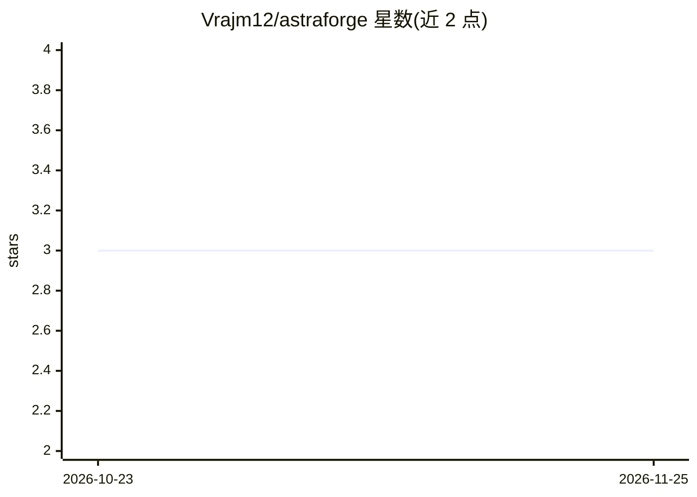

# Vrajm12/astraforge

⭐ 3 · JavaScript · MIT · 推送 2026-11-16 · [GitHub](https://github.com/Vrajm12/astraforge) · [官网](https://veerajmatnale.me/work/astraforge) · 个人维护

**为 Google Antigravity 提供结构化推理与可靠执行技能集**

面向 Google Antigravity 宿主的模型无关技能包，内含 12 个 SKILL.md 格式技能（推理、架构、实现、对抗评审、验证、研究诚信、写作、产品设计、数据/AI 工程、安全工具操作）以及共享协议、可复现评估场景和基于 Python 标准库的结构校验脚本。设计原则强调渐进披露、证据优先、按风险匹配计划深度。安装方式为把技能目录复制进宿主识别的技能目录，npm 包发布前需本地运行 CLI。README 明确声明不改变底层模型能力，且未验证宿主实际激活行为。

## 筛选速览

| 维度 | 判定 | 备注 |
|---|---|---|
| AI 角色 | `ai-knowledge` | 知识聚合/清单类 |
| 许可风险 | `permissive` | MIT |
| 部署形态 | `library` | 以包/库形式分发 |
| 模型依赖 | — | README 未给出锁定关系 |
| 硬件要求 | — | 无带数字的原话,不猜 |
| 安装摩擦 | `low` | 无编译、无系统依赖或容器化 |
| 成熟度 | — | 结构信号不足 |

## 能力要点

- 12 个聚焦技能 + 共享协议 + 评估场景 + 结构校验脚本
- SKILL.md 目录约定，复制到宿主技能目录即可被发现
- scripts/validate.py 仅用 Python 标准库校验元数据与引用
- 声明模型无关：不伪装改变模型身份或能力

## 适用场景

- 为 Antigravity agent 会话加装结构化工作流与专用技能
- 在安装前后用评估场景对 agent 行为做可复现打分
- 团队需要统一的安全与证据标准约束工具操作

## 场景标签

`提示工程` · 领域:Agent 开发

## 证据(README 行号)

> L1: # AstraForge — Custom Antigravity Skill System
> L9: - `skills/`: 12 focused skills, each with a concise `SKILL.md` and optional supporting references.
> L77: The package uses the directory-based `SKILL.md` convention described in the Antigravity Skill Vault README supplied

## 星数曲线

2026-10-23 3 → 2026-11-25 3（+0）

---
*卡片 v1 · prompt 1.4 · 生成 2026-11-22 · 置信度 high · 依据 README sha `fc4077f4e86c` · [字段定义](../../DATASET.md)*
