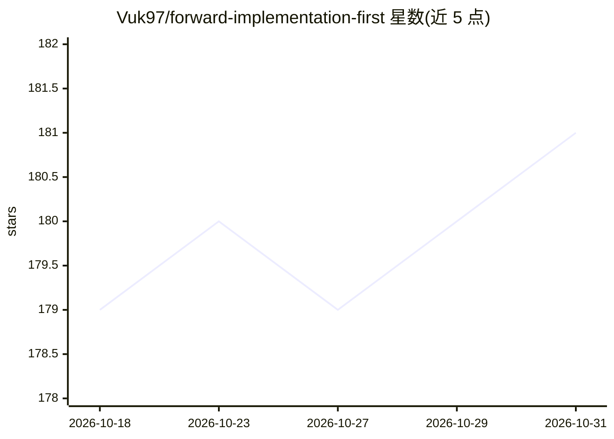

# Vuk97/forward-implementation-first

⭐ 181 · Shell · MIT · 推送 2026-08-31 · [GitHub](https://github.com/Vuk97/forward-implementation-first) · 个人维护

**给编码 agent 的行为规则技能：先交付实现，不被自造的簿记卡住**

一份约 150 行 Markdown 的 Agent Skills 规则文件（含 YAML frontmatter），供 Claude Code、Codex 等编码 agent 加载。机制：要求 agent 在每个动作前把其分类为语义实现、聚焦验证或行政簿记三类，默认执行前两类、跳过第三类；同时划定 forward cursor 回放规则与并行工作不变量，但明确不充当调度器。安装为运行 install.sh 把 SKILL.md 复制到各 agent 技能目录；技能是否被加载由模型自行决定。

## 筛选速览

| 维度 | 判定 | 备注 |
|---|---|---|
| AI 角色 | `ai-ecosystem` | LLM/agent 周边工具 |
| 许可风险 | `permissive` | MIT |
| 部署形态 | `None` |  |
| 模型依赖 | — | README 未给出锁定关系 |
| 硬件要求 | — | 无带数字的原话,不猜 |
| 安装摩擦 | `low` | 无编译、无系统依赖或容器化 |
| 成熟度 | — | 结构信号不足 |

## 能力要点

- 三分类决策规则：语义实现/聚焦验证/行政簿记
- 明确保留产品自身完整性、输入版本标识与断言结果的测试
- 并行不变量：单一发布写入者、消费前验证、不等全部 worker
- 模型无关、工具无关、领域无关

## 适用场景

- 多阶段流水线 agent 因元数据漂移反复作废已完成阶段时使用
- 长时间运行、无人逐步盯守的 agent 任务
- 多个 agent/会话操作同一仓库的场景

## 场景标签

`提示工程` · 领域:Agent 开发

## 证据(README 行号)

> L3: An agent skill that stops a coding agent from getting stuck servicing its own
> L137: The skill is a single Markdown file with YAML frontmatter, following the

## 星数曲线

2026-10-18 179 → 2026-10-31 181（+2）

---
*卡片 v1 · prompt 1.4 · 生成 2026-10-23 · 置信度 high · 依据 README sha `c88456699353` · [字段定义](../../DATASET.md)*
