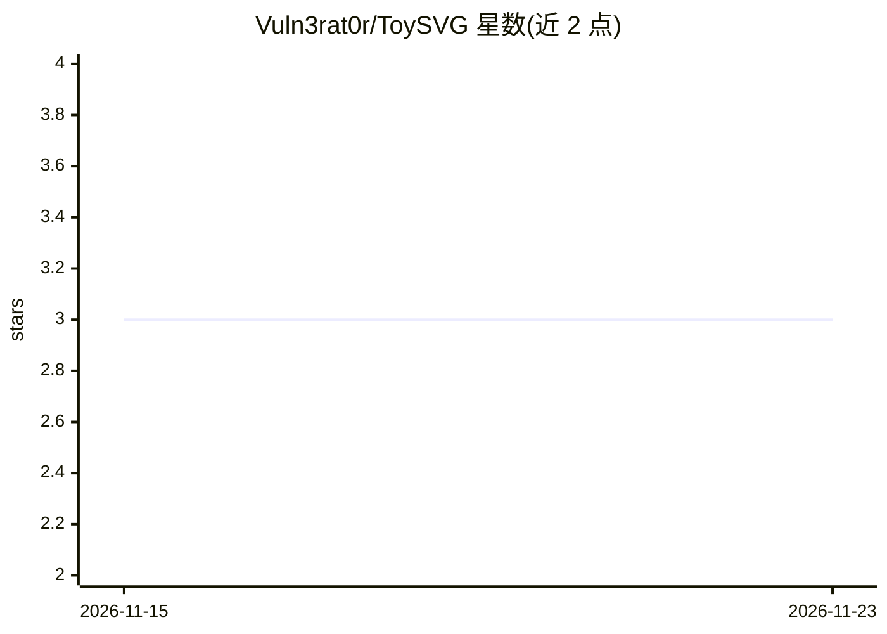

# Vuln3rat0r/ToySVG

⭐ 3 · Python · MIT · 推送 2026-10-22 · [GitHub](https://github.com/Vuln3rat0r/ToySVG) · [官网](https://www.kaggle.com/benchmarks/tasks/riadmohamed42/) · 个人维护

**评测 VLM 几何感知与 SVG 矢量重建的确定性基准**

一个确定性基准数据集与评测工具，考察视觉语言模型在几何视觉感知与光栅到矢量 SVG 路径重建上的能力。模型接收 256×256 画布上隐藏 SVG 路径渲染的单色图像，在给定绘图命令预算（k∈{16,48,160,∞}）内合成矢量路径。评分采用闭式几何函数（soft IoU、对称 Chamfer 距离、Euler 拓扑守恒），评测循环中不含 LLM-as-a-judge。通过三组受控切分（ID-CLEAN/ID-DEGRADED/OOD-DISJOINT）量化记忆回召与感知泛化的差距，附 45 页规格论文与 Kaggle 任务。

## 筛选速览

| 维度 | 判定 | 备注 |
|---|---|---|
| AI 角色 | `ai-knowledge` | 知识聚合/清单类 |
| 许可风险 | `permissive` | MIT |
| 部署形态 | `None` |  |
| 模型依赖 | — | README 未给出锁定关系 |
| 硬件要求 | — | 无带数字的原话,不猜 |
| 安装摩擦 | `low` | 无编译、无系统依赖或容器化 |
| 成熟度 | `idea` | |

## 能力要点

- 闭式确定性评分：同一答案恒得同一分数，无评判模型
- 显式命令预算 k∈{16,48,160,∞} 与简约比率 ρ(k)
- 三切分架构量化记忆回召（Δ_mem）与感知泛化
- 附 45 页规格论文、SHA-256 内容哈希与可复现协议

## 适用场景

- 复现并核验已发布的 VLM 评测分数
- 诊断模型的纯视觉感知能力与代码合成差距
- 评估模型在记忆不可用的 OOD 切分上的几何泛化

## 场景标签

`模型评测` · 领域:评测与运维

## 证据(README 行号)

> L12: **ToySVG** is a deterministic benchmark evaluating **Vision-Language Models (VLMs)** and **Multimodal LLMs** on geo
> L23: * 🚀 **Kaggle Benchmarks Ready**: Direct execution against frontier models (**GPT-6 Astra**, **Gemini 4 Argon**, **C

## 星数曲线

2026-11-15 3 → 2026-11-23 3（+0）

---
*卡片 v1 · prompt 1.4 · 生成 2026-11-22 · 置信度 high · 依据 README sha `287bc30cf6d6` · [字段定义](../../DATASET.md)*
