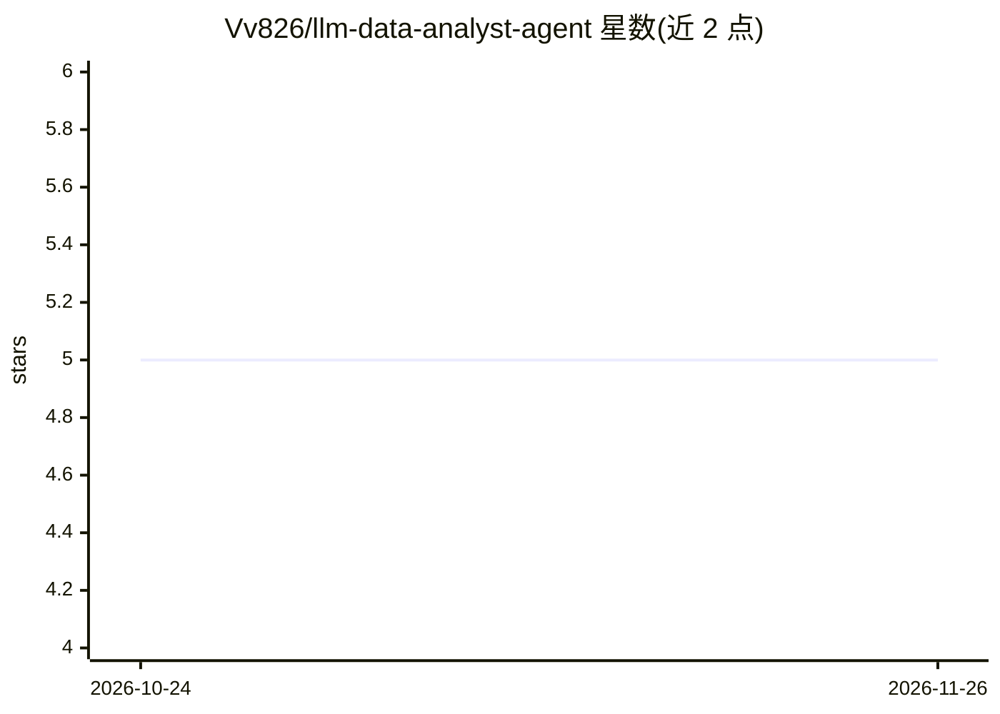

# Vv826/llm-data-analyst-agent

⭐ 5 · Python · MIT · 推送 2026-10-15 · [GitHub](https://github.com/Vv826/llm-data-analyst-agent) · 个人维护 · 中文 README

**自然语言数据分析 Agent + RAG 知识库问答的一站式平台**

基于 LangChain/LangGraph 构建的数据与文档智能处理平台，含四大模块：CSV/Excel 自助数据分析（5 个 pandas 工具、自动可视化）、RAG 知识库问答（ChromaDB + 本地 ONNX 嵌入、两阶段 LLM 重排）、LangGraph Supervisor 多智能体协同（专家节点并行 fan-out）、AI pandas 代码生成（AST 校验 + 人工确认 + 受限执行三层防御）。后端 FastAPI，前端 React 19，通过 MCP Server 将 7 个工具暴露给任意 MCP 客户端，带检索评测体系与可观测性告警。

## 筛选速览

| 维度 | 判定 | 备注 |
|---|---|---|
| AI 角色 | `ai-native` | 本体是模型或模型工具 |
| 许可风险 | `permissive` | MIT |
| 部署形态 | `desktop` | 安装包/桌面程序 |
| 模型依赖 | — | README 未给出锁定关系 |
| 硬件要求 | — | 无带数字的原话,不猜 |
| 安装摩擦 | `low` | 无编译、无系统依赖或容器化 |
| 成熟度 | — | 结构信号不足 |

## 能力要点

- 两阶段检索（向量宽召回 + LLM 重排），评测集 Hit@1 100%
- LangGraph Supervisor 多智能体协同，专家节点并行执行
- MCP Server 暴露 7 个工具，Claude Desktop/Cursor 可直接接入
- AI 代码生成三层安全：AST 静态校验 → 人工确认 → 受限执行

## 适用场景

- 用自然语言提问分析上传的 CSV/Excel 数据并生成图表
- 对 PDF/Word 等文档建知识库做溯源问答
- 跨模块任务：核对知识库结论与表格数据是否一致
- 把表格分析/检索工具接入任意 MCP 客户端复用

## 场景标签

`数据分析` `RAG` `文档问答` `多智能体` · 领域:Agent 开发

## 证据(README 行号)

> L11: 基于大模型的一站式数据与文档智能处理平台，包含自然语言数据分析 Agent、RAG 知识库问答、多智能体协同、AI 代码生成四大模块。
> L12: 后端 FastAPI + LangChain/LangGraph（原生 tool calling + `StateGraph` 多智能体），前端 React 19 + Ant Design，

## 星数曲线

2026-10-24 5 → 2026-11-26 5（+0）

---
*卡片 v1 · prompt 1.4 · 生成 2026-11-21 · 置信度 high · 依据 README sha `3525cfcbde1b` · [字段定义](../../DATASET.md)*
