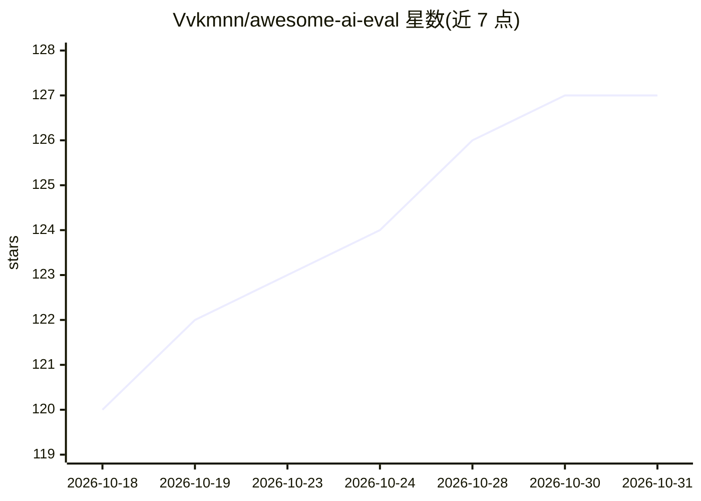

# Vvkmnn/awesome-ai-eval

⭐ 127 · CC0-1.0 · 推送 2026-10-13 · [GitHub](https://github.com/Vvkmnn/awesome-ai-eval) · 个人维护

**AI 评测资源清单：LLM、RAG 与 agent 的评测工具与基准目录**

一个 awesome-list 形式的编目仓库，收录 LLM、RAG 管道与 AI agent 的可靠性、准确性与安全性评测资源。按评测框架、检索评测、对抗测试、自托管/托管/云评测平台、通用与专项基准（长上下文、Agent、多模态、安全）、排行榜与论文指南组织。条目以一行简介列出，不提供代码或安装方式。面向需要选型评测工具与基准的开发者。

## 筛选速览

| 维度 | 判定 | 备注 |
|---|---|---|
| AI 角色 | `ai-knowledge` | 知识聚合/清单类 |
| 许可风险 | `viral` | CC0-1.0 |
| 部署形态 | `None` |  |
| 模型依赖 | — | README 未给出锁定关系 |
| 硬件要求 | — | 无带数字的原话,不猜 |
| 安装摩擦 | `low` | 无编译、无系统依赖或容器化 |
| 成熟度 | — | 结构信号不足 |

## 能力要点

- 覆盖评测框架、平台、基准、排行榜、论文与指南六大板块
- 包含 RAG 检索评测、对抗/红队、安全基准等专项类目
- 收录中文基准条目（FinEval、LAiW、SuperCLUE-Agent）

## 适用场景

- 为 LLM/RAG/agent 项目挑选评测框架与工具
- 查找长上下文、Agent、安全等方向的基准数据集
- 了解评测平台的托管与自托管选项

## 场景标签

`模型评测` `精选清单` · 领域:评测与运维

## 证据(README 行号)

> L5: > Assessing the reliability, accuracy, and safety of large language models, RAG pipelines, and AI agents.
> L9: ## Tools

## 星数曲线

2026-10-18 120 → 2026-10-31 127（+7）

---
*卡片 v1 · prompt 1.4 · 生成 2026-10-23 · 置信度 high · 依据 README sha `6d8057d0a938` · [字段定义](../../DATASET.md)*
