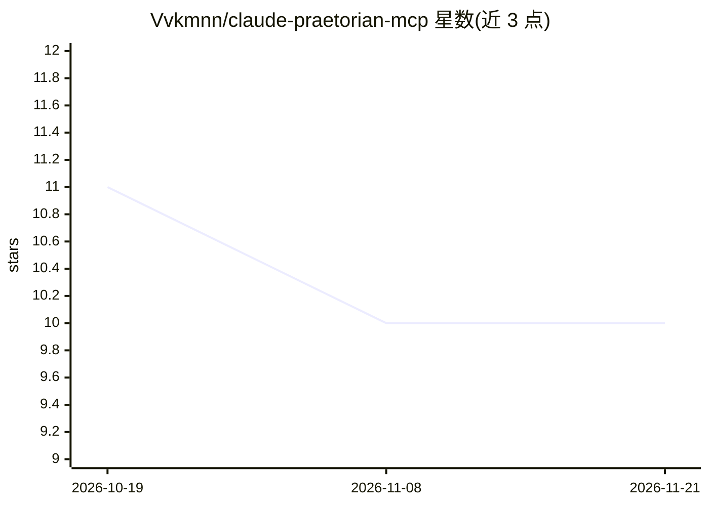

# Vvkmnn/claude-praetorian-mcp

⭐ 10 · TypeScript · MIT · 推送 2026-03-16 · [GitHub](https://github.com/Vvkmnn/claude-praetorian-mcp) · [官网](https://www.npmjs.com/package/claude-praetorian-mcp) · 个人维护

**面向 Claude Code 的上下文压缩 MCP 服务器**

一个 Model Context Protocol 服务器，为 Claude Code 提供上下文压缩与回收：把网页研究、子代理任务输出和对话内容压成 TOON 格式的结构化快照存入项目本地 .claude/praetorian 目录，支持 praetorian_compact 与 praetorian_restore 工具、基于 Jaccard 相似度的合并去重和倒排索引关键词搜索。无需数据库或外部服务，仅用纯文件存储，离线运行。可通过 npx 直接接入，另提供可选的 skill 与插件（hooks 自动化）安装方式。

## 筛选速览

| 维度 | 判定 | 备注 |
|---|---|---|
| AI 角色 | `ai-ecosystem` | LLM/agent 周边工具 |
| 许可风险 | `permissive` | MIT |
| 部署形态 | `library` | 以包/库形式分发 |
| 模型依赖 | — | README 未给出锁定关系 |
| 硬件要求 | — | 无带数字的原话,不猜 |
| 安装摩擦 | `low` | 无编译、无系统依赖或容器化 |
| 成熟度 | — | 结构信号不足 |

## 能力要点

- praetorian_compact / praetorian_restore 两个 MCP 工具实现压缩与恢复
- TOON 格式存储，README 称较 YAML/JSON 减少 30-60% token
- Jaccard 相似度合并去重，倒排索引关键词搜索，无向量嵌入
- 纯文件存储、无数据库、离线运行

## 适用场景

- 长时间编码会话后压缩上下文以继续工作
- 恢复此前压缩的研究结论与架构决策
- 管理子代理任务输出的 token 占用

## 场景标签

`Agent 记忆` · 领域:Agent 开发

## 证据(README 行号)

> L5: An Model Context Protocol (MCP) server for aggressive context compaction in Claude Code. Save 90%+ tokens by compact
> L22: claude mcp add claude-praetorian-mcp -- npx claude-praetorian-mcp
> L83: ## features

## 星数曲线

2026-10-19 11 → 2026-11-21 10（-1）

---
*卡片 v1 · prompt 1.4 · 生成 2026-11-20 · 置信度 high · 依据 README sha `ce7b0be1e2c7` · [字段定义](../../DATASET.md)*
