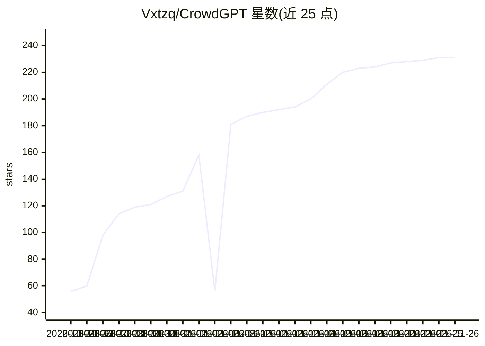

# Vxtzq/CrowdGPT

⭐ 231 · HTML · GPL-3.0 · 推送 2026-11-25 · [GitHub](https://github.com/Vxtzq/CrowdGPT) · [官网](https://www.crowdgpt.net/) · 个人维护

**用志愿者闲置算力分布式训练大模型的协作框架**

CrowdGPT 将大模型训练分散到参与者的个人机器上：客户端从 Hugging Face 下载当前权重，与本池（3 人）共享同一数据分片、种子和步数进行训练，上传权重增量，由协调服务器去噪合并后发布到 Crowd-v1（658M 参数 decoder，Qwen3 tokenizer）。提供 backprop/solo/relora/dust/mosaic 五种训练范式、稀疏增量与低秩编码等带宽压缩选项、多 token 预测，以及协调端的 DiLoCo 外层动量与锚点步。无 API key、无数据中心；客户端不运行服务器下发的代码。提供安装脚本、Docker 部署、桌面窗口与 headless/TUI 模式、--doctor 环境诊断。

## 筛选速览

| 维度 | 判定 | 备注 |
|---|---|---|
| AI 角色 | `ai-ecosystem` | LLM/agent 周边工具 |
| 许可风险 | `viral` | GPL-3.0 |
| 部署形态 | `desktop` | 安装包/桌面程序 |
| 模型依赖 | — | README 未给出锁定关系 |
| 硬件要求 | — | 无带数字的原话,不猜 |
| 安装摩擦 | `medium` | 含编译或系统依赖之一 |
| 成熟度 | — | 结构信号不足 |

## 能力要点

- 五种可选训练范式（backprop/solo/relora/dust/mosaic），默认关闭均不改变 v1 行为
- 支持 NVIDIA CUDA、AMD ROCm/DirectML、Intel XPU、Apple MPS 与纯 CPU 后端，装不下显存的层流式放入内存
- 增量压缩：Engram 行筛选与 sparse/1-bit delta 编码减少上传带宽
- 提供桌面窗口、headless、终端 TUI 仪表盘与 --doctor 只读诊断

## 适用场景

- 用自己闲置的 GPU/CPU 参与分布式大模型训练
- 在没有数据中心或付费集群的情况下协作训练模型
- 研究联邦学习/群体训练的范式与通信压缩机制

## 场景标签

`模型训练` · 领域:训练与推理

## 证据(README 行号)

> L118: CrowdGPT is a **project for training arbitrary big LLMs** using volunteered compute.
> L126: 1. The client asks the server for a task and is placed in a pool of 3 volunteers with compatible hardware.
> L131: The current model, Crowd-v1, is a 658M-parameter decoder (24 layers, 2048-token context, Qwen3 tokenizer) with an 

## 星数曲线

2026-10-24 56 → 2026-11-26 231（+175）

---
*卡片 v1 · prompt 1.4 · 生成 2026-11-25 · 置信度 mid · 依据 README sha `77f6695b6fa4` · [字段定义](../../DATASET.md)*
