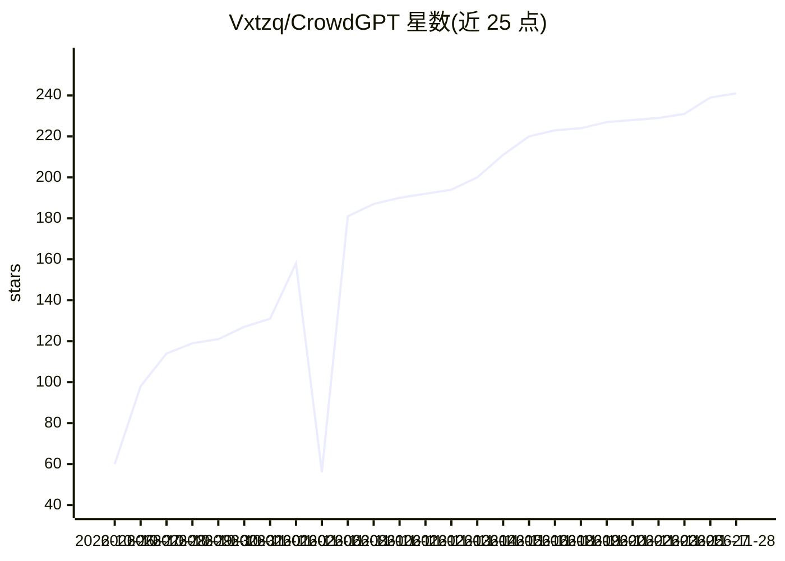

# Vxtzq/CrowdGPT

⭐ 241 · HTML · GPL-3.0 · 推送 2026-11-27 · [GitHub](https://github.com/Vxtzq/CrowdGPT) · [官网](https://www.crowdgpt.net/) · 个人维护

**志愿者贡献闲置算力、分布式训练大语言模型的开源框架**

CrowdGPT 是一个不依赖数据中心训练 LLM 的协作框架：客户端向协调服务器领取任务，与硬件兼容的 3 名志愿者组成一组，从 Hugging Face 下载当前权重、在自己数据分片上训练并上传权重增量，服务器剔除异常后合并为全局模型并发布到 Crowd-v1 仓库。当前模型为 658M 参数 decoder（Qwen3 tokenizer）。提供 5 种训练范式（backprop/solo/relora/dust/mosaic）、稀疏增量编码、multi-token prediction 等 opt-in 机制；提供桌面窗口与 headless CLI、--doctor 环境诊断，安装器自动检测硬件匹配 PyTorch 构建。

## 筛选速览

| 维度 | 判定 | 备注 |
|---|---|---|
| AI 角色 | `ai-ecosystem` | LLM/agent 周边工具 |
| 许可风险 | `viral` | GPL-3.0 |
| 部署形态 | `desktop` | 安装包/桌面程序 |
| 模型依赖 | — | README 未给出锁定关系 |
| 硬件要求 | — | 无带数字的原话,不猜 |
| 安装摩擦 | `medium` | 含编译或系统依赖之一 |
| 成熟度 | — | 结构信号不足 |

## 能力要点

- 5 种训练范式（backprop/solo/relora/dust/mosaic）可选
- 稀疏增量与 engram 行过滤减少上传带宽
- 支持 NVIDIA/AMD/Intel Arc/Apple Silicon/CPU 后端
- --doctor 只读环境检查与终端训练仪表盘

## 适用场景

- 用个人 GPU/CPU 空闲算力参与大模型协作训练
- 自建协调服务器组织分布式训练轮次
- 无数据中心或 API key 条件下参与开源模型训练

## 场景标签

`模型训练` · 领域:训练与推理

## 证据(README 行号)

> L119: CrowdGPT is a **project for training arbitrary big LLMs** using volunteered compute.
> L127: 1. The client asks the server for a task and is placed in a pool of 3 volunteers with compatible hardware.

## 星数曲线

2026-10-26 60 → 2026-11-28 241（+181）

---
*卡片 v1 · prompt 1.4 · 生成 2026-11-26 · 置信度 mid · 依据 README sha `1ea89a102f98` · [字段定义](../../DATASET.md)*
