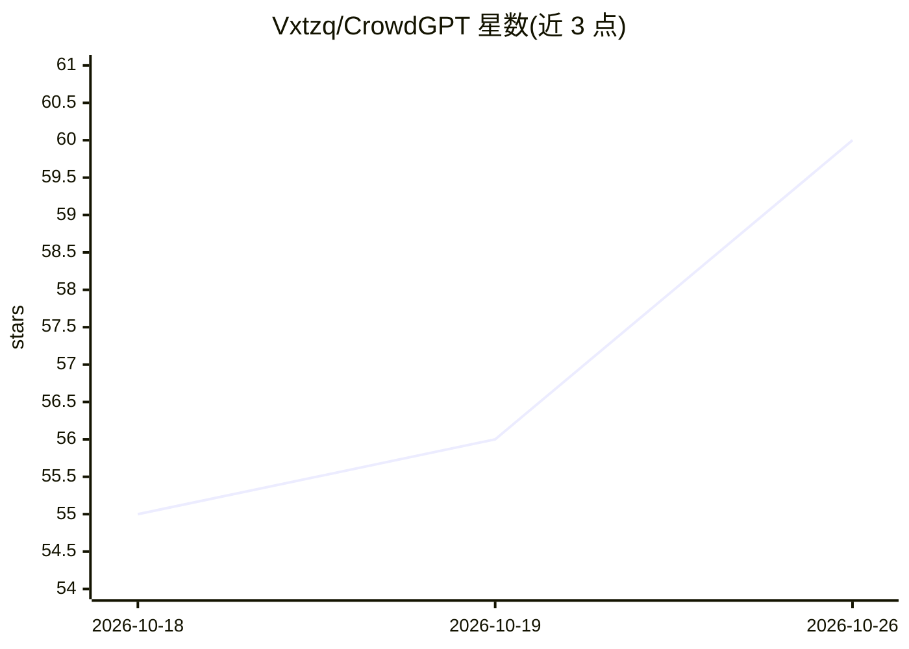

# Vxtzq/CrowdGPT

⭐ 60 · Python · GPL-3.0 · 推送 2026-10-25 · [GitHub](https://github.com/Vxtzq/CrowdGPT) · [官网](https://www.crowdgpt.net/) · 个人维护

**志愿者算力分布式训练大语言模型的开源项目**

CrowdGPT 是一个利用志愿贡献的计算资源分布式训练任意规模 LLM 的项目：训练任务分散到参与机器上执行，而非依赖单一数据中心，不要求付费、API key 或集中 GPU 集群。训练数据通过 pull request 策划贡献，架构细节见 ARCHITECTURE.md。提供 Linux/macOS 与 Windows 的一键安装脚本，旧版 git clone 手动安装方式标记为 deprecated，支持按 NVIDIA 等硬件安装依赖后运行 client.py 客户端，另有 GUI 版本。

## 筛选速览

| 维度 | 判定 | 备注 |
|---|---|---|
| AI 角色 | `ai-ecosystem` | LLM/agent 周边工具 |
| 许可风险 | `viral` | GPL-3.0 |
| 部署形态 | `desktop` | 安装包/桌面程序 |
| 模型依赖 | — | README 未给出锁定关系 |
| 硬件要求 | — | 无带数字的原话,不猜 |
| 安装摩擦 | `low` | 无编译、无系统依赖或容器化 |
| 成熟度 | — | 结构信号不足 |

## 能力要点

- 跨参与机器分布式训练大 LLM，无需数据中心
- 无需付费、API key 或集中 GPU 集群
- 训练数据通过 pull request 社区策划
- 提供 Linux/macOS/Windows 一键安装脚本与 GUI 版本

## 适用场景

- 贡献闲置算力参与开源 LLM 的分布式训练
- 不依赖数据中心地训练任意规模语言模型
- 通过 PR 参与训练数据的策划与贡献

## 场景标签

`模型训练` · 领域:训练与推理

## 证据(README 行号)

> L23: CrowdGPT is a **project for training arbitrary big LLMs** using volunteered compute.
> L25: Instead of one datacenter doing all the work, CrowdGPT distributes training across participating machines.

## 星数曲线

2026-10-18 55 → 2026-10-26 60（+5）

---
*卡片 v1 · prompt 1.4 · 生成 2026-10-24 · 置信度 mid · 依据 README sha `ebd4053b1e89` · [字段定义](../../DATASET.md)*
