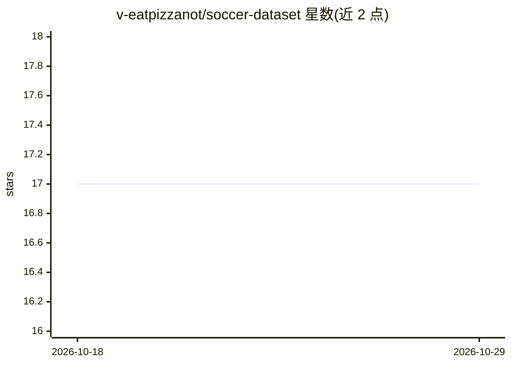

# v-eatpizzanot/soccer-dataset

⭐ 17 · Python · NOASSERTION · 推送 2026-07-05 · [GitHub](https://github.com/v-eatpizzanot/soccer-dataset) · 个人维护

**全球足球比赛清洗数据集：67 万场赛事供 BTTS 与进球建模**

面向体育分析与机器学习研究者的开放足球数据集 v1.0.0：收录 673,966 场比赛、271 个联赛、182,125 名球员，覆盖 2008-2027 年，含 xG 与赔率数据。数据源为 API-Football 与 football-data.co.uk，经 ID 对账、按规范键去重、xG 假零修复、泄漏防护（known_at 时间戳）与 50+ 项 12 维 QA 门控后发布。仓库内含管线代码、文档与 ~1k 行样本，全量 parquet 数据托管在 Hugging Face，可用 load_dataset() 或 pandas 直接读取。

## 筛选速览

| 维度 | 判定 | 备注 |
|---|---|---|
| AI 角色 | `ai-knowledge` | 知识聚合/清单类 |
| 许可风险 | `none` | NOASSERTION |
| 部署形态 | `None` |  |
| 模型依赖 | — | README 未给出锁定关系 |
| 硬件要求 | — | 无带数字的原话,不猜 |
| 安装摩擦 | `low` | 无编译、无系统依赖或容器化 |
| 成熟度 | — | 结构信号不足 |

## 能力要点

- 673,966 场比赛、271 联赛、182,125 名球员（2008-2027）
- 两源对账去重与 xG 假零置 NULL 修复
- 12 维 QA 门控 50+ 阻断检查后才发布
- post-match 字段带 known_at 时间戳防泄漏

## 适用场景

- 做 BTTS 与进球建模的训练与回测
- 体育分析研究获取带赔率与 xG 的比赛数据
- 按联赛覆盖状态筛选数据避免误判缺失历史

## 场景标签

 · 领域:体育数据/机器学习数据集

## 证据(README 行号)

> L3: **A cleaned, deduplicated, quality-gated open dataset of global football match data for
> L9: > The **full data** is published on Hugging Face:

## 星数曲线

2026-10-18 17 → 2026-10-29 17（+0）

---
*卡片 v1 · prompt 1.4 · 生成 2026-10-29 · 置信度 high · 依据 README sha `2ba6cdfb4026` · [字段定义](../../DATASET.md)*
