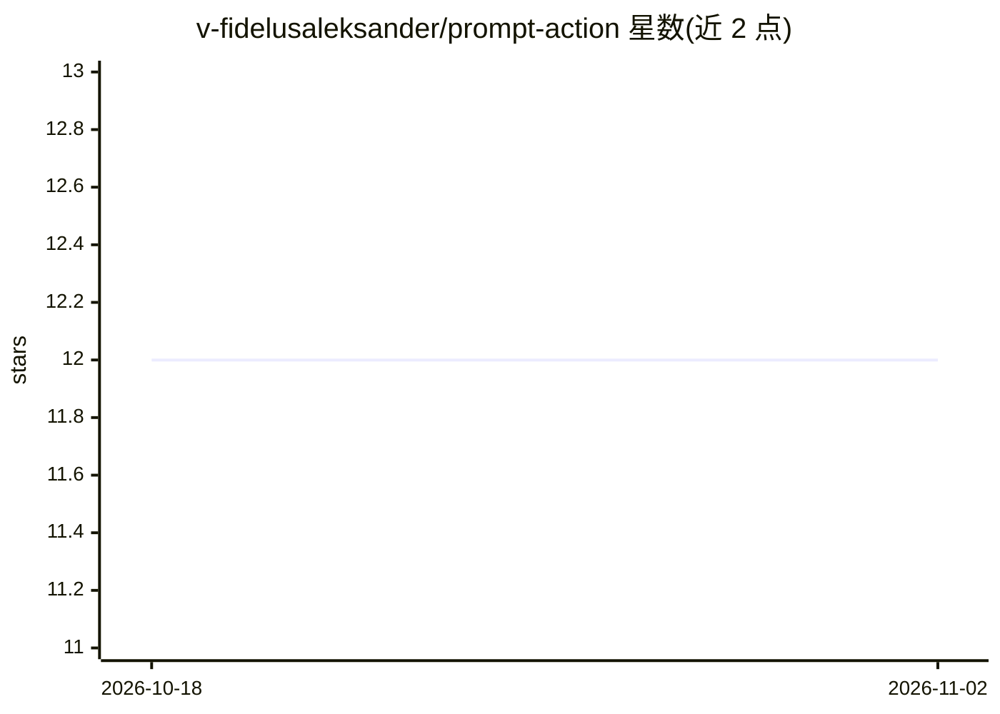

# v-fidelusaleksander/prompt-action

⭐ 12 · TypeScript · MIT · 推送 2026-09-21 · [GitHub](https://github.com/v-fidelusaleksander/prompt-action) · 个人维护

**在 GitHub Actions 工作流中直接向 GitHub Models 发送提示词的 Action**

GitHub Action，供用户在 CI 工作流中向 GitHub Models 发送提示词并获取文本输出。支持通过 system-prompt 设定角色、以 JSON Schema 文件约束结构化输出、使用 Nunjucks 语法（{{ variable }}）与 vars 参数生成动态提示词，提示词可来自内联文本或文件以维护可复用模板。需授予 contents:read 与 models:read 权限，默认模型 gpt-4o，输出为 text 字段。以 workflow YAML 引用方式使用，无独立安装步骤。

## 筛选速览

| 维度 | 判定 | 备注 |
|---|---|---|
| AI 角色 | `ai-ecosystem` | LLM/agent 周边工具 |
| 许可风险 | `permissive` | MIT |
| 部署形态 | `None` |  |
| 模型依赖 | — | README 未给出锁定关系 |
| 硬件要求 | — | 无带数字的原话,不猜 |
| 安装摩擦 | `low` | 无编译、无系统依赖或容器化 |
| 成熟度 | — | 结构信号不足 |

## 能力要点

- 通过 prompt/prompt-file 与 system-prompt 输入调用 AI 模型
- response-schema-file 支持 JSON Schema 结构化输出
- Nunjucks 变量模板（vars）生成动态提示词
- 需 contents:read 与 models:read 权限，默认模型 gpt-4o

## 适用场景

- 在 CI 工作流中让模型处理文本并使用其输出
- 用 JSON Schema 约束模型返回结构化数据
- 以文件模板加变量生成可复用的动态提示词

## 场景标签

`提示工程` · 领域:Agent 开发

## 证据(README 行号)

> L7: A GitHub Action that lets you Prompt AI directly in your workflows.
> L86: |`model`|The AI model to use. See available models|No|`gpt-4o`|

## 星数曲线

2026-10-18 12 → 2026-11-02 12（+0）

---
*卡片 v1 · prompt 1.4 · 生成 2026-10-31 · 置信度 high · 依据 README sha `85b3fed1bca5` · [字段定义](../../DATASET.md)*
