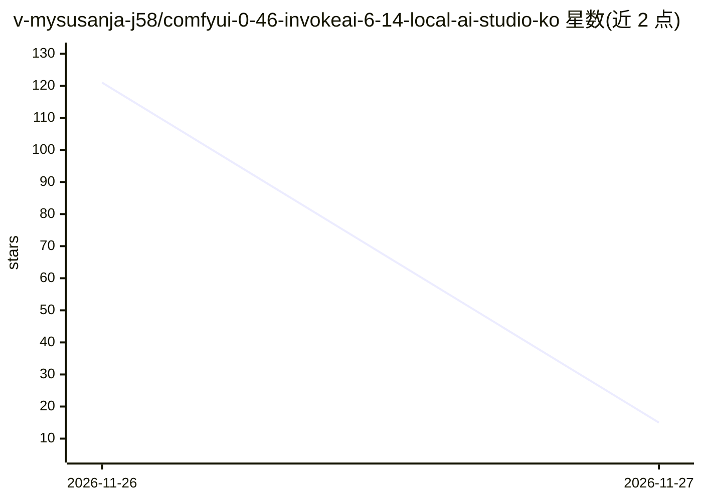

# v-mysusanja-j58/comfyui-0-46-invokeai-6-14-local-ai-studio-ko

⭐ — · [GitHub]() · 个人维护 · 中文 README

**面向 Windows x64 的游戏作弊工具，借 ComfyUI/InvokeAI 命名分发**

README 提供一个名为 comfyui-0-46-invokeai-6-14-local-ai-studio-ko 的 Windows x64 可执行程序（zip 加密码解压后以管理员权限运行）。功能模块描述包括外部叠加渲染、2D 雷达与战利品过滤、指针偏移扫描、输入平滑与 JSON 配置切换，L57 自述该二进制为 game cheat（游戏作弊）类独立程序。名称借用 ComfyUI 与 InvokeAI，但正文未提供图像或视频生成功能说明。

## 筛选速览

| 维度 | 判定 | 备注 |
|---|---|---|
| AI 角色 | `ai-enhanced` | 去掉 AI 部分产品仍成立 |
| 许可风险 | `permissive` | — |
| 部署形态 | `desktop` | 安装包/桌面程序 |
| 模型依赖 | — | README 未给出锁定关系 |
| 硬件要求 | — | 无带数字的原话,不猜 |
| 安装摩擦 | `medium` | 含编译或系统依赖之一 |
| 成熟度 | — | 结构信号不足 |

## 能力要点

- 以 zip 密码分发的 Windows x64 单可执行程序
- 自述为独立 game cheat 二进制（L57）
- 提供 JSON 配置档案一键切换与 OBS/ShadowPlay/Discord 屏幕捕获排除

## 适用场景

- 该 README 描述的功能面向游戏内叠加显示与雷达/过滤用途
- 不适用于 AI 图像或视频生成场景

## 场景标签

 · 领域:游戏工具（自述 game cheat）

## 证据(README 行号)

> L57: Because `comfyui-0-46-invokeai-6-14-local-ai-studio-ko-v1.2.0-win64.exe` (build `3DD1B7`) is an independent `game c
> L80:  `comfyui` · `invokeai` · `local-ai-studio` · `generative-ai` · `vram-optimization` · `windows-11` · `windows` · `w

## 星数曲线

2026-11-26 121 → 2026-11-27 15（-106）

---
*卡片 v1 · prompt 1.4 · 生成 2026-11-26 · 置信度 mid · 依据 README sha `8ad020a3a3d0` · [字段定义](../../DATASET.md)*
