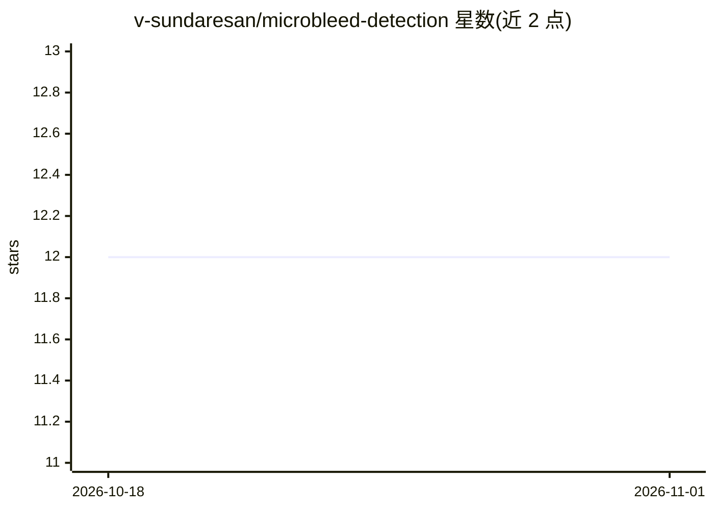

# v-sundaresan/microbleed-detection

⭐ 12 · Python · 推送 2026-03-19 · [GitHub](https://github.com/v-sundaresan/microbleed-detection) · 个人维护

**基于知识蒸馏的脑微出血 MRI 自动检测工具**

PyTorch 实现的脑微出血（CMB）检测工具 MicrobleedNet，采用两阶段深度学习流程：先用径向对称特征结合图像强度做候选检测，再用学生-教师网络（多任务教师模型经响应式知识蒸馏训练学生模型）区分真候选与假阳性。提供 CLI（train/evaluate/fine_tune/loo_validate），支持 NIfTI 格式 T2* GRE/SWI/QSM 单模态输入，检测耗时 <5 分钟/扫描，提供 MWSC 与 UKBB 预训练模型下载。README 自述为 beta 版。

## 筛选速览

| 维度 | 判定 | 备注 |
|---|---|---|
| AI 角色 | `ai-native` | 本体是模型或模型工具 |
| 许可风险 | `none` | — |
| 部署形态 | `library` | 以包/库形式分发 |
| 模型依赖 | — | README 未给出锁定关系 |
| 硬件要求 | — | 无带数字的原话,不猜 |
| 安装摩擦 | `low` | 无编译、无系统依赖或容器化 |
| 成熟度 | `idea` | |

## 能力要点

- 两阶段检测：径向对称特征候选检测 + 学生-教师网络判别
- 响应式知识蒸馏训练学生模型（特征提取器+patch 级分类器）
- 提供预训练模型（MWSC/UKBB）与 CLI 训练/评估/微调子命令
- 支持 NIfTI 单模态输入，检测耗时 <5 分钟/扫描

## 适用场景

- 在 T2*/SWI/QSM MRI 上自动检出脑微出血灶
- 用自有标注数据训练或微调 CMB 检测模型
- 对扫描数据做留一验证评估模型性能

## 场景标签

`目标检测` · 领域:感知与多模态

## 证据(README 行号)

> L1: # microbleed-detection
> L25: For the initial CMB candidate detection, in addition to the intensity characteristics, we use the radial symmetry p

## 星数曲线

2026-10-18 12 → 2026-11-01 12（+0）

---
*卡片 v1 · prompt 1.4 · 生成 2026-10-31 · 置信度 mid · 依据 README sha `fa6dd17d8978` · [字段定义](../../DATASET.md)*
