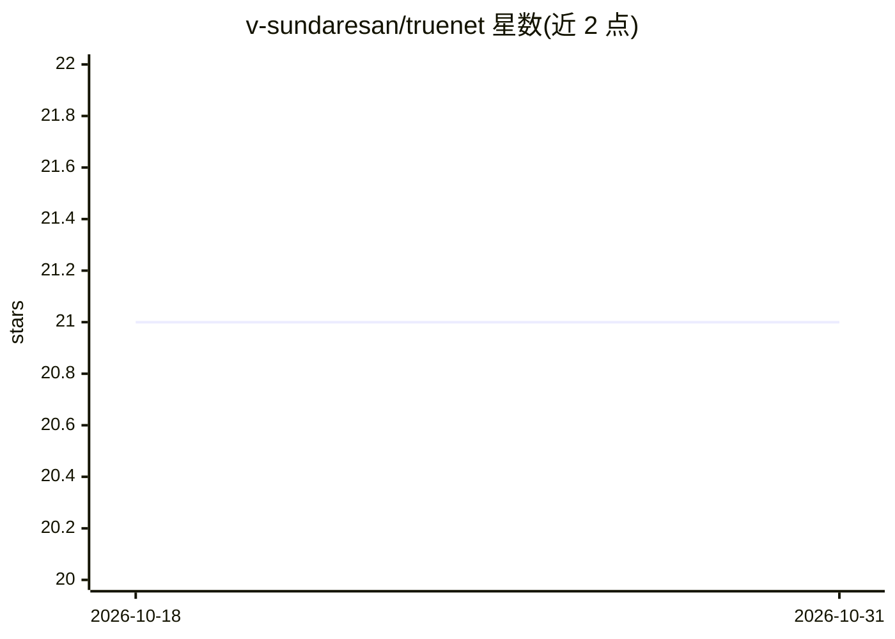

# v-sundaresan/truenet

⭐ 21 · Python · NOASSERTION · 推送 2026-10-15 · [GitHub](https://github.com/v-sundaresan/truenet) · 组织维护

**脑 MRI 白质高信号分割的三平面 U-Net 深度学习工具**

TrUE-Net 是用于脑部 MR 图像白质高信号（WMH）分割的 PyTorch 深度学习工具，实现三平面集成 U-Net 模型。提供 evaluate、train、fine_tune、cross_validate 四种子命令，并附带在 MICCAI WMH 挑战赛数据与 UK Biobank 数据上训练的 6 个预训练模型（FLAIR/T1 单通道与双通道）。数据需预处理（去颅骨、偏场校正、配准），配套 prepare_truenet_data 脚本依赖 FSL。属于 FSL 软件库的一部分，可经 conda 或 pip 独立安装。

## 筛选速览

| 维度 | 判定 | 备注 |
|---|---|---|
| AI 角色 | `ai-native` | 本体是模型或模型工具 |
| 许可风险 | `none` | NOASSERTION |
| 部署形态 | `library` | 以包/库形式分发 |
| 模型依赖 | — | README 未给出锁定关系 |
| 硬件要求 | — | 无带数字的原话,不猜 |
| 安装摩擦 | `low` | 无编译、无系统依赖或容器化 |
| 成熟度 | — | 结构信号不足 |

## 能力要点

- 三平面集成 U-Net 模型，支持 T1/FLAIR 双通道输入
- 提供 6 个预训练模型（MICCAI WMH 与 UK Biobank 训练）
- 支持训练、微调、留一交叉验证
- prepare_truenet_data 脚本完成 MNI 重定向、去颅骨、配准等预处理

## 适用场景

- 对 T1/FLAIR 脑 MRI 做白质高信号自动分割
- 在自己的标注数据上微调或从头训练分割模型
- 小样本数据集下用预训练模型直接推理

## 场景标签

`目标检测` · 领域:感知与多模态

## 证据(README 行号)

> L3: ## DL tool for white matter hyperintensities segmentation
> L101:     - truenet evaluate        Applying a saved/pretrained TrUE-Net model for testing

## 星数曲线

2026-10-18 21 → 2026-10-31 21（+0）

---
*卡片 v1 · prompt 1.4 · 生成 2026-10-28 · 置信度 high · 依据 README sha `0d51980291d4` · [字段定义](../../DATASET.md)*
