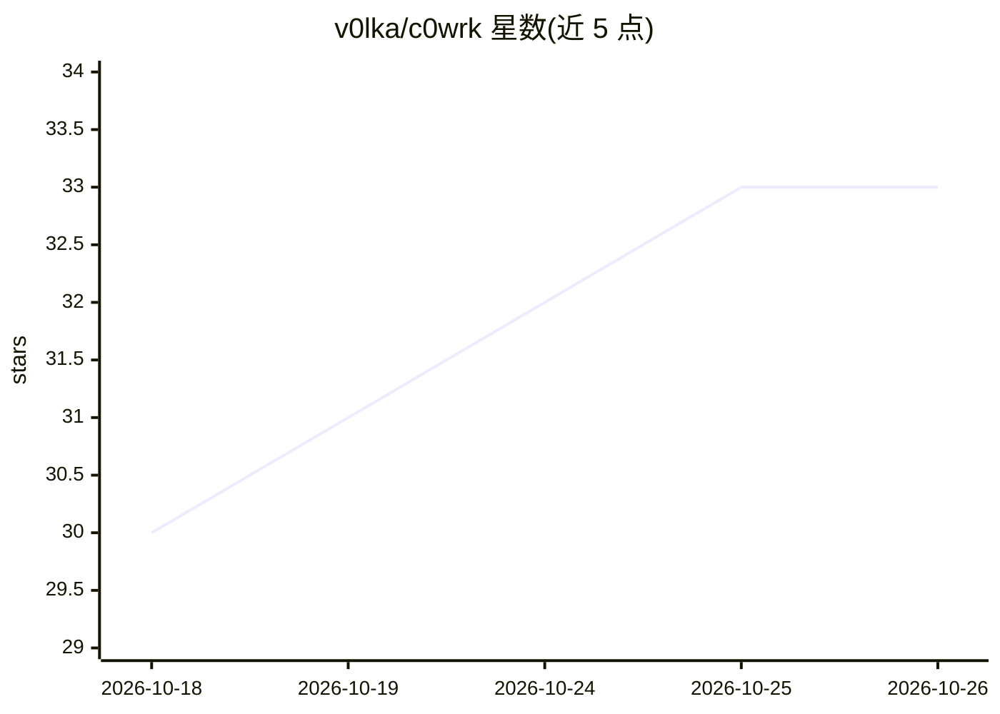

# v0lka/c0wrk

⭐ 33 · Go · MIT · 推送 2026-10-25 · [GitHub](https://github.com/v0lka/c0wrk) · 组织维护

**桌面端研究与编码 AI agent：多步任务的计划-实现-审查闭环**

面向需要多步完成的工作（研究、编码、写作）的桌面应用。工作开始前生成可审查的图式计划，独立步骤以并行子代理隔离执行；goal 模式下以事先批准的可校验"完成"定义为契约持续工作并自验。支持逐块/逐文件评论真实 diff、暂存提交推送与分支历史车道图。分层安全策略含工具能力组（allow/user_confirm/deny）、路径围栏与命令黑名单。模型接入 Anthropic、OpenAI、ChatGPT 及兼容端点，本地 ONNX Runtime 运行嵌入。发布六平台预构建包（未签名），Linux 需 GTK3/WebKit2GTK 运行库，CUDA13/OpenVINO 为 GPU 加速变体。自述处于 stable beta，API 与配置格式可能变动。

## 筛选速览

| 维度 | 判定 | 备注 |
|---|---|---|
| AI 角色 | `ai-native` | 本体是模型或模型工具 |
| 许可风险 | `permissive` | MIT |
| 部署形态 | `desktop` | 安装包/桌面程序 |
| 模型依赖 | local-ok | 支持本地模型 |
| 硬件要求 | — | 无带数字的原话,不猜 |
| 安装摩擦 | `medium` | 含编译或系统依赖之一 |
| 成熟度 | `idea` | |

## 能力要点

- 可审查的 DAG 计划 + 并行隔离子代理 + 可恢复检查点
- goal 模式：事先批准的可校验完成定义与证据自验
- 工具能力组策略、路径围栏、命令黑名单等分层安全
- 本地 ONNX Runtime 嵌入，混合语义+词法搜索

## 适用场景

- 让 AI agent 端到端完成多步编码任务并审查 diff 后提交
- 设置明确完成条件让 agent 持续迭代直至目标达成
- 在受控策略下让 agent 执行研究或写作任务

## 场景标签

`编码 Agent` `AI 助手` · 领域:编码与开发

## 证据(README 行号)

> L8: c0wrk is for work that won't fit in a single reply — research, coding, writing, anything that takes more than one st
> L19: - **Your model, your machine.** Works with Anthropic, OpenAI, ChatGPT, and OpenAI- or Anthropic-compatible endpoint

## 星数曲线

2026-10-18 30 → 2026-10-26 33（+3）

---
*卡片 v1 · prompt 1.4 · 生成 2026-10-25 · 置信度 high · 依据 README sha `b7346073eea4` · [字段定义](../../DATASET.md)*
