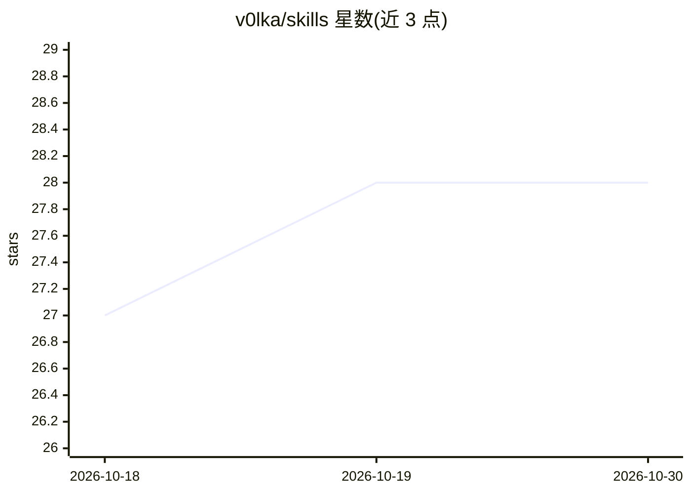

# v0lka/skills

⭐ 28 · Python · MIT · 推送 2026-10-24 · [GitHub](https://github.com/v0lka/skills) · 个人维护

**面向研发任务的 AI agent 技能合集（约 40 个技能）**

一套可安装到 AI agent 的技能（skills）集合，覆盖研究（deeper-research、study-paper、TRIZ 求解）、工程研究流程（假设图、实验跟踪、综合报告）、安全（SECURITY.md 生成、OWASP 审查）、写作（俄语文本人性化）与开发（Go 惯用法、规范驱动开发、代码评审）等类别。每个技能独立针对一种任务意图，通过 npx skills CLI 整体或按名安装，也可手动经 agent 接口加载。MIT 许可。

## 筛选速览

| 维度 | 判定 | 备注 |
|---|---|---|
| AI 角色 | `ai-knowledge` | 知识聚合/清单类 |
| 许可风险 | `permissive` | MIT |
| 部署形态 | `library` | 以包/库形式分发 |
| 模型依赖 | — | README 未给出锁定关系 |
| 硬件要求 | — | 无带数字的原话,不猜 |
| 安装摩擦 | `low` | 无编译、无系统依赖或容器化 |
| 成熟度 | — | 结构信号不足 |

## 能力要点

- 研究、工程研究、安全、写作、开发等 7 大类技能
- 工程研究类覆盖从立项到综合报告的迭代流程（假设图 Mermaid DAG）
- 安全类生成含威胁模型的 SECURITY.md 并做 OWASP 审查
- npx skills add 支持整体或按技能名安装

## 适用场景

- 给 AI agent 装上论文研读与多源研究能力
- 用规范驱动开发技能维护项目规格与代码一致
- 对代码变更做 OWASP/CVSS 安全审查

## 场景标签

`代码审查` `网络安全` `科研工具` · 领域:编码与开发

## 证据(README 行号)

> L3: A set of AI agent skills designed to solve research and development tasks.
> L24: Skills that automate the Iterative Engineering Research Methodology — from initial brief to final report. See engin

## 星数曲线

2026-10-18 27 → 2026-10-30 28（+1）

---
*卡片 v1 · prompt 1.4 · 生成 2026-10-26 · 置信度 high · 依据 README sha `02a5845a81c6` · [字段定义](../../DATASET.md)*
