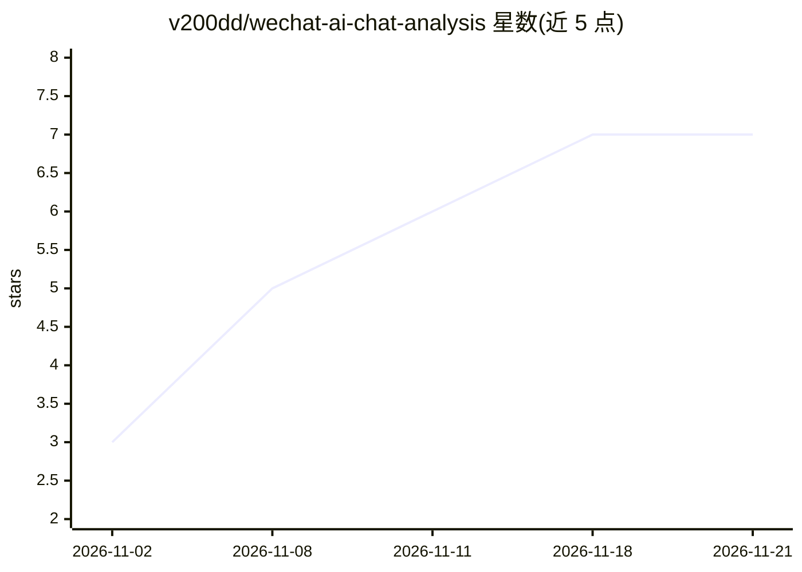

# v200dd/wechat-ai-chat-analysis

⭐ 7 · Objective-C · MIT · 推送 2026-11-01 · [GitHub](https://github.com/v200dd/wechat-ai-chat-analysis) · 个人维护 · 中文 README

**越狱 iOS 微信内嵌 AI 助手：意图分析与建议回复**

基于 Theos 构建的微信 Tweak（deb 包），读取聊天上下文后在消息气泡下方内嵌 AI 分析卡：判断对方意图与情绪、生成多条建议回复并可一键填入；支持按联系人保存记忆档案、长按单条消息分析、`#画图/#改图/#视频` 指令生成多媒体并发送、会话级开关与可选自动回复。需要已越狱 iOS 14.0+ 设备、Theos 与 ldid，经 make package 编译后 scp/dpkg 安装；接口默认 OpenAI 端点，兼容任意 OpenAI 格式接口，流式走 SSE，不支持时回退普通请求。微信版本升级可能导致 hook 失效。

## 筛选速览

| 维度 | 判定 | 备注 |
|---|---|---|
| AI 角色 | `ai-native` | 本体是模型或模型工具 |
| 许可风险 | `permissive` | MIT |
| 部署形态 | `None` |  |
| 模型依赖 | — | README 未给出锁定关系 |
| 硬件要求 | — | 无带数字的原话,不猜 |
| 安装摩擦 | `low` | 无编译、无系统依赖或容器化 |
| 成熟度 | — | 结构信号不足 |

## 能力要点

- 意图分析与建议回复，流式输出内嵌在消息气泡下方
- 按联系人保存记忆档案，分析时自动带上历史摘要
- 聊天内 `#画图/#改图/#视频` 指令直接生成并发送到会话
- 支持任意 OpenAI 兼容接口，rootful/rootless 均可安装

## 适用场景

- 聊天前分析对方消息的意图与情绪，获取多条风格话术
- 按联系人维护偏好与历史摘要辅助回复
- 在会话内直接生成图片或视频并发送

## 场景标签

`AI 助手` `图像生成` `视频生成` · 领域:对话与助手

## 证据(README 行号)

> L3: 微信 AI 助手 Tweak（Theos 工程）：读取当前聊天上下文，做意图分析、生成建议回复，并支持记忆档案、画图与视频。
> L9: - **意图分析**：判断对方这句话的潜台词、情绪与意图，流式输出，边生成边显示。
> L10: - **建议回复**：一次生成多条不同风格的话术，点一下即可填入输入框。

## 星数曲线

2026-11-02 3 → 2026-11-21 7（+4）

---
*卡片 v1 · prompt 1.4 · 生成 2026-11-20 · 置信度 high · 依据 README sha `90e887f6c516` · [字段定义](../../DATASET.md)*
