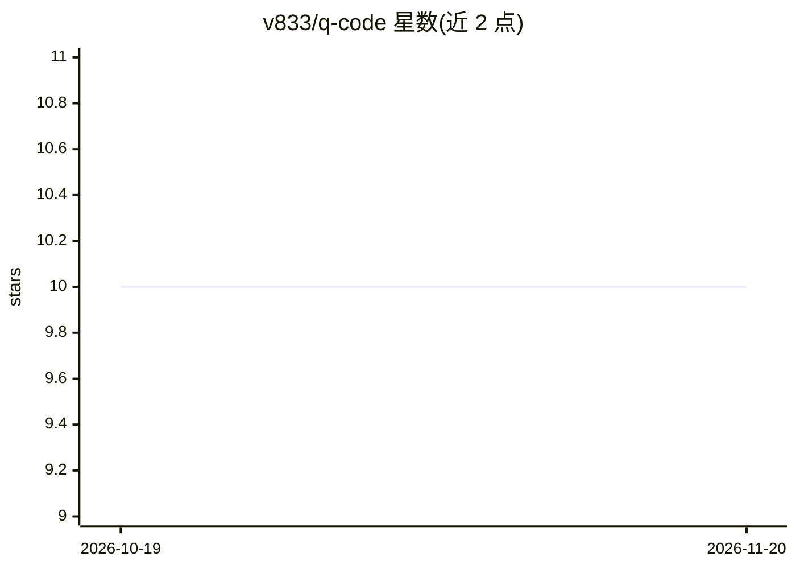

# v833/q-code

⭐ 10 · TypeScript · MIT · 推送 2026-10-27 · [GitHub](https://github.com/v833/q-code) · [官网](https://q-code.wq1115.com/) · 个人维护 · 中文 README

**面向开发者的命令行 Agent 框架，提供工具调用与多智能体协作**

基于 Vercel AI SDK 构建的 Node.js CLI Agent 框架，以 TUI 形式运行。提供工具调用、Shell 后台长任务、Plan Mode、任务图持久化、上下文自动压缩、会话持久化、跨对话项目记忆、Skills 渐进式披露、后台 SubAgent、Worktree 隔离、Agent Teams 多智能体协作与 MCP 扩展。通过 OpenAI 兼容 API 接入模型，另提供 Codex CLI 兼容的无头 exec 协议、ACP v1 stdio 接入与本地 Web Dashboard，内置审计日志与 Langfuse/OpenTelemetry 导出。需要 Node.js ≥ 22 与 API Key。

## 筛选速览

| 维度 | 判定 | 备注 |
|---|---|---|
| AI 角色 | `ai-ecosystem` | LLM/agent 周边工具 |
| 许可风险 | `permissive` | MIT |
| 部署形态 | `desktop` | 安装包/桌面程序 |
| 模型依赖 | — | README 未给出锁定关系 |
| 硬件要求 | — | 无带数字的原话,不猜 |
| 安装摩擦 | `low` | 无编译、无系统依赖或容器化 |
| 成熟度 | — | 结构信号不足 |

## 能力要点

- 工具调用、Plan Mode、Task V2 任务图与上下文自动压缩
- Agent Teams 多智能体协作、后台 SubAgent 与 Worktree 隔离
- Codex CLI 兼容 exec 与 ACP v1 stdio 接入
- MCP 扩展、GitLab Wiki 知识库与本地 Web Dashboard

## 适用场景

- 在终端里以 Agent 方式检查和处理代码项目
- 搭建多智能体协作的自动化开发流程
- 将 Agent 以无头协议嵌入 IDE 或其他客户端

## 场景标签

`Agent 框架` `多智能体` · 领域:Agent 开发

## 证据(README 行号)

> L5:  基于 AI SDK 的命令行 Agent 框架
> L7: 基于 AI SDK 的命令行 Agent 框架，支持工具调用、可后台运行的 Shell 长任务、Plan Mode、Task V2 持久化任务图、上下文自动压缩、会话持久化、Codex CLI 兼容的无头 `exec`、ACP v1
> L14: |AI SDK|`ai` (Vercel AI SDK) + `@ai-sdk/openai`|

## 星数曲线

2026-10-19 10 → 2026-11-20 10（+0）

---
*卡片 v1 · prompt 1.4 · 生成 2026-11-19 · 置信度 high · 依据 README sha `7521ec7df616` · [字段定义](../../DATASET.md)*
