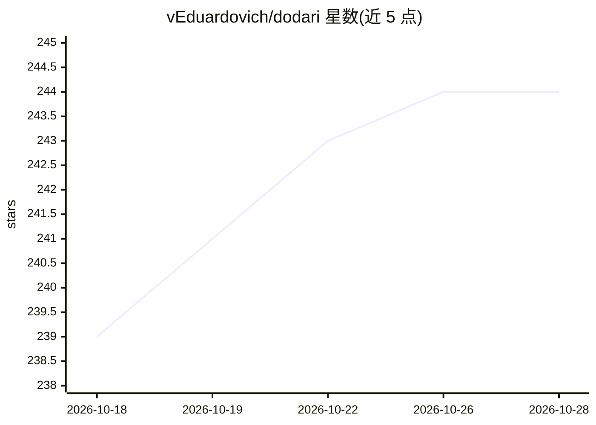

# vEduardovich/dodari

⭐ 244 · Python · Apache-2.0 · 推送 2026-10-12 · [GitHub](https://github.com/vEduardovich/dodari) · [官网](https://finpin.himion.com/dodari) · 个人维护 · 中文 README

**面向读者的多语言 AI 整书翻译工具：翻译 EPUB/PDF/TXT**

Dodari 2 是多语言 AI 翻译应用，读取 EPUB、PDF、TXT 文档并生成译文，支持 12 种语言互译、自动语言与书籍体裁检测、可选翻译语气风格、术语表一致性。翻译引擎有两种：Claude/ChatGPT 订阅用户经官方 CLI（如 claude-haiku-5-5）调用自有订阅，或本地 Gemma 模型（Ollama/MLX/vLLM）。输出双语对照与纯译文两个文件；PDF 译文保存为 EPUB 以保留排版。以 Gradio Web 界面运行（127.0.0.1:7860），提供 Mac/Windows/Linux 启动脚本，另附给 Codex/Claude Code 的 AI 助手安装指引。本地模型路径对硬件有明确要求（Windows 推荐 24GB VRAM）。

## 筛选速览

| 维度 | 判定 | 备注 |
|---|---|---|
| AI 角色 | `ai-native` | 本体是模型或模型工具 |
| 许可风险 | `permissive` | Apache-2.0 |
| 部署形态 | `library` | 以包/库形式分发 |
| 模型依赖 | local-ok | 支持本地模型 |
| 硬件要求 | `gpu-24g` | |
| 安装摩擦 | `low` | 无编译、无系统依赖或容器化 |
| 成熟度 | — | 结构信号不足 |

## 能力要点

- EPUB/PDF/TXT 整书翻译，输出原文对照与纯译文两份文件
- 自动语言检测、体裁检测与可选取翻译风格
- 支持 Claude/ChatGPT 订阅 CLI 或本地 Gemma 模型两种引擎
- AI 抽取术语表并在全书保持译名一致

## 适用场景

- 把外语小说或技术书整本翻译成母语阅读
- 订阅了 Claude/ChatGPT 的用户用现有订阅完成翻译
- 在本地电脑离线用 Gemma 模型翻译电子书

## 场景标签

 · 领域:文档翻译/电子书

## 证据(README 行号)

> L4: Dodari 2 is a multilingual AI translator that translates EPUB, PDF, and TXT documents with genre-aware, context-sens
> L22: 1. Translates `EPUB (e-books)`, `PDF`, and `TXT` files.
> L31: 10. Claude and ChatGPT (Codex) subscribers can translate with their own subscription via the official CLI, and pick

## 星数曲线

2026-10-18 239 → 2026-10-28 244（+5）

---
*卡片 v1 · prompt 1.4 · 生成 2026-10-22 · 置信度 mid · 依据 README sha `9f76874b6eba` · [字段定义](../../DATASET.md)*
