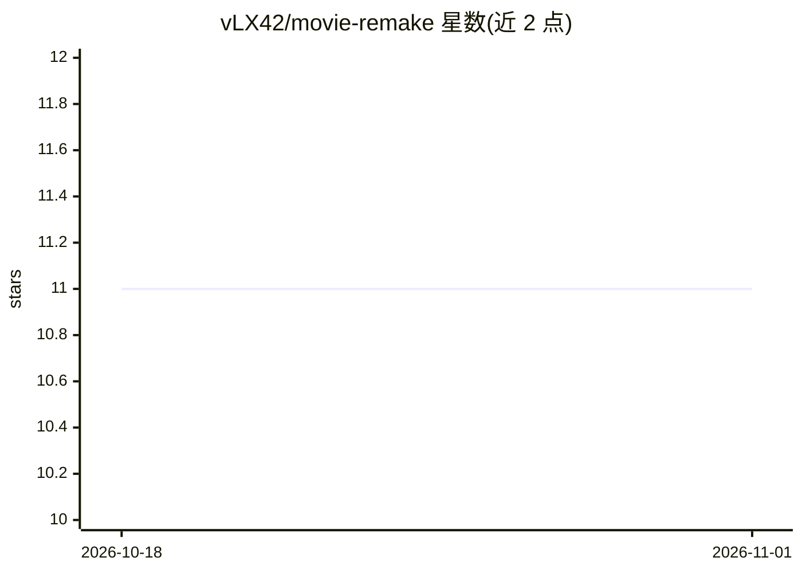

# vLX42/movie-remake

⭐ 11 · TypeScript · 推送 2026-02-23 · [GitHub](https://github.com/vLX42/movie-remake) · [官网](https://movie-remake.vlx.dk/) · 组织维护

**用 ChatGPT-4 与 Stable Diffusion 生成好莱坞电影翻拍创意的 Web 演示**

基于 Next.js、React 18 Server Components 与 App Router 的开源 Web 项目：通过 TMDB API 搜索电影，由 OpenAI API（ChatGPT-4）与 Stable Diffusion 生成电影翻拍内容。因生成过程运行时间长，API 以 Cloudflare Worker（SSE 流式）实现，另附 AWS Lambda 响应流式示例，用 Cloudflare KV 与 Images 缓存。仓库含前端、Worker、Lambda 示例与讲解幻灯片四个目录，源于 DFDS 内部知识分享，README 明确要求不要整站克隆，应使用其中的流式示例自行构建应用。

## 筛选速览

| 维度 | 判定 | 备注 |
|---|---|---|
| AI 角色 | `ai-native` | 本体是模型或模型工具 |
| 许可风险 | `none` | — |
| 部署形态 | `None` |  |
| 模型依赖 | — | README 未给出锁定关系 |
| 硬件要求 | — | 无带数字的原话,不猜 |
| 安装摩擦 | `low` | 无编译、无系统依赖或容器化 |
| 成熟度 | — | 结构信号不足 |

## 能力要点

- TMDB 电影搜索 + ChatGPT-4 与 Stable Diffusion 生成翻拍内容
- Cloudflare Worker 以 SSE 流式返回生成结果
- AWS Lambda 响应流式（response streaming）替代 SSE 的示例
- Cloudflare KV 与 Images 做结果缓存

## 适用场景

- 参考其 SSE/Lambda 流式实现构建自己的长耗时 AI 生成应用
- 学习 Next.js App Router 与 Cloudflare Worker 的组合架构
- 查看电影翻拍生成演示的运行效果

## 场景标签

`图像生成` · 领域:内容生成

## 证据(README 行号)

> L3: Welcome to the Hollywood Movie Remake Generator, an open source web project that generates creative remakes of Holly
> L7: - Movie search using The Movie Database (TMDB) API
> L8: - Movie generation using SSE (Server-Side Events) in a Cloudflare worker

## 星数曲线

2026-10-18 11 → 2026-11-01 11（+0）

---
*卡片 v1 · prompt 1.4 · 生成 2026-11-01 · 置信度 high · 依据 README sha `6a157636f720` · [字段定义](../../DATASET.md)*
