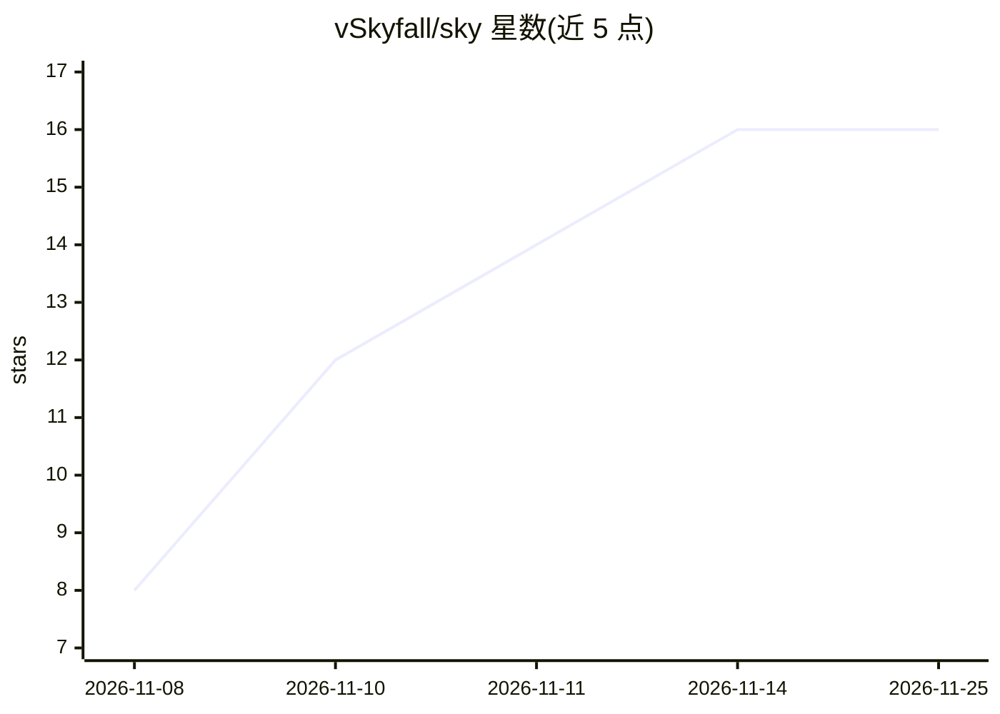

# vSkyfall/sky

⭐ 16 · HTML · MIT · 推送 2026-11-06 · [GitHub](https://github.com/vSkyfall/sky) · 个人维护

**面向 Claude Code 的土耳其语一体化开发者插件：技能+agent+命令+hook**

Claude Code 的插件：提供 214 个 skill（其中 17 个针对土耳其本地场景自动加载，其余经 /sky: 命令手动调用）、3 个土耳其语 agent（校对/翻译/文案）、25 个命令、8 个防护 hook（危险命令确认、可疑包拦截、.env 保护），以及一个本地运行的 Sky Pano 浏览面板（npm start 于 localhost:4242，仅需 Node 18+）。通过 claude plugin 命令安装，声明零依赖、MIT 许可。覆盖前端、后端、土耳其支付/税务等主题的领域指南。

## 筛选速览

| 维度 | 判定 | 备注 |
|---|---|---|
| AI 角色 | `ai-ecosystem` | LLM/agent 周边工具 |
| 许可风险 | `permissive` | MIT |
| 部署形态 | `self-host` | docker 或自建部署 |
| 模型依赖 | locked-api |  |
| 硬件要求 | — | 无带数字的原话,不猜 |
| 安装摩擦 | `low` | 无编译、无系统依赖或容器化 |
| 成熟度 | — | 结构信号不足 |

## 能力要点

- 214 个 skill + 3 个土耳其语 agent + 25 个命令 + 8 个防护 hook
- 17 个土耳其本地 skill（支付、e-Fatura、KVKK 等）按需自动加载
- 本地 Sky Pano 面板：搜索、过滤、hook 时间线、⌘K 全局搜索
- 8 个 hook 做危险命令确认、假包拦截与 .env 保护

## 适用场景

- 在 Claude Code 中按土耳其本地规范做支付、税务、电商开发
- 通过 /sky: 命令快速调用架构、安全审计等专家指南
- 在本地面板浏览和检索全部技能、命令与 hook

## 场景标签

`编码 Agent` · 领域:编码与开发

## 证据(README 行号)

> L7: **Claude Code için Türkçe, her şey dahil geliştirici eklentisi.**
> L36: Claude Code tek başına zaten güçlü. Sky ona **ne zaman neyi nasıl yapacağını bilen bir ekip** ekler: her alan için
> L61: claude plugin marketplace add vSkyfall/sky

## 星数曲线

2026-11-08 8 → 2026-11-25 16（+8）

---
*卡片 v1 · prompt 1.4 · 生成 2026-11-18 · 置信度 mid · 依据 README sha `e309b36b0826` · [字段定义](../../DATASET.md)*
