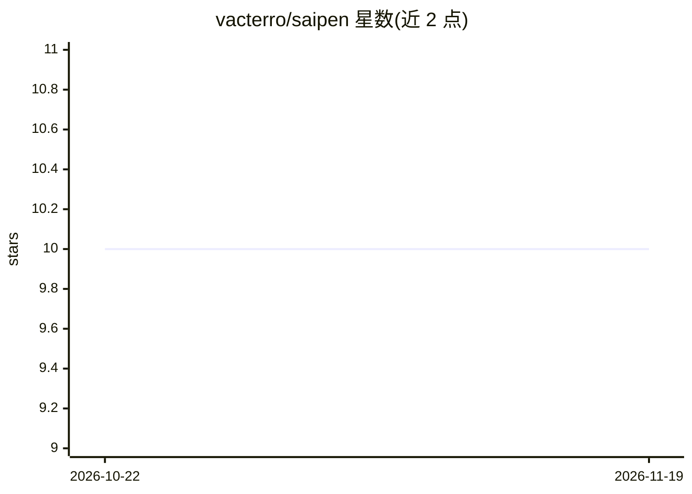

# vacterro/saipen

⭐ 10 · Python · MIT · 推送 2026-11-06 · [GitHub](https://github.com/vacterro/saipen) · [官网](https://github.com/vacterro/saipen/blob/main/GUIDE.md) · 个人维护

**给 AI 编码 agent 的纯文件续接协议：冷启动恢复任务状态**

SAIPEN 是一套面向 AI 编码 agent 的续接协议：项目记忆以纯文件（STATE.md/BOARD.md/LOG.md/KNOWLEDGE/）存放在代码旁，agent 会话结束后，新会话（cold agent）仅凭这些文件中的持久化 next_action 恢复工作，无需聊天历史或托管数据库。安装通过 git clone 加平台脚本注入 agent 指令，支持 Claude Code、Codex、Gemini、OpenCode、Aider 等；校验器仅用 Python 标准库实现，要求 Git 与 Python 3.11+，无需 pip 安装。协议含核心状态机与可选的自主维护层。

## 筛选速览

| 维度 | 判定 | 备注 |
|---|---|---|
| AI 角色 | `ai-ecosystem` | LLM/agent 周边工具 |
| 许可风险 | `permissive` | MIT |
| 部署形态 | `None` |  |
| 模型依赖 | — | README 未给出锁定关系 |
| 硬件要求 | — | 无带数字的原话,不猜 |
| 安装摩擦 | `low` | 无编译、无系统依赖或容器化 |
| 成熟度 | — | 结构信号不足 |

## 能力要点

- 纯文件项目记忆（.saipen/），可读、可 diff、可随代码提交
- 基于持久化 next_action 的机器校验恢复机制（stdlib-only validator）
- 支持 Claude Code、Codex、Gemini、OpenCode、Aider、Antigravity 及通用 ~/.agents/skills
- Core 不依赖 Maintenance，禁用自主演进后仍是完整续接协议

## 适用场景

- agent 会话结束后在新会话中无重新简报地继续任务
- 跨多个 agent 工具统一管理项目任务状态与恢复语义
- 将任务上下文随 Git 仓库持久化，克隆后可恢复同一身份

## 场景标签

`Agent 记忆` · 领域:Agent 开发

## 证据(README 行号)

> L5: **Continuation protocol for AI coding agents.**
> L7: Project memory lives beside the code in plain files, so a cold agent can resume from the persisted next action witho
> L64: Requires **Git, Python 3.11 or newer**, and a coding agent. No `pip` install,

## 星数曲线

2026-10-22 10 → 2026-11-19 10（+0）

---
*卡片 v1 · prompt 1.4 · 生成 2026-11-19 · 置信度 high · 依据 README sha `4294ebdb8f83` · [字段定义](../../DATASET.md)*
