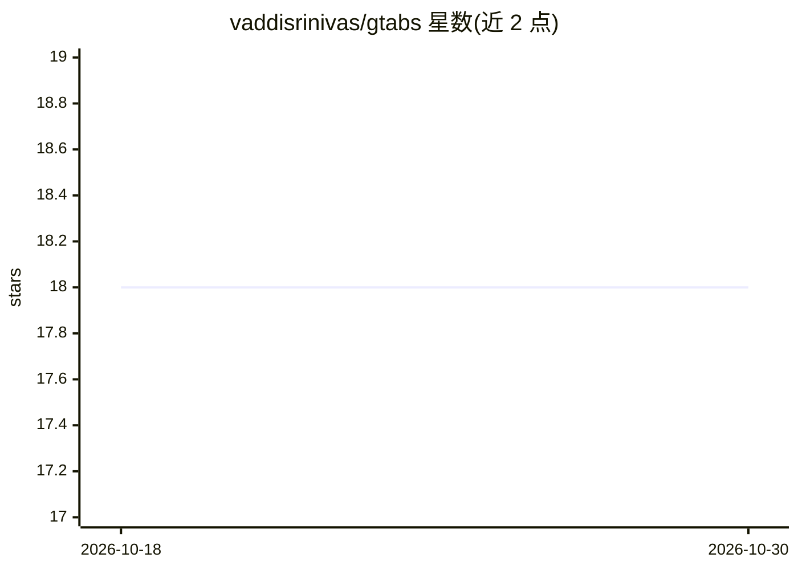

# vaddisrinivas/gtabs

⭐ 18 · TypeScript · MIT · 推送 2026-07-08 · [GitHub](https://github.com/vaddisrinivas/gtabs) · 个人维护

**用 LLM 自动整理 Chrome 标签页的浏览器扩展**

Chrome 扩展，调用任意 LLM 将窗口内标签页按主题归入彩色分组。默认使用 Chrome 内置 Gemini Nano（本地运行，需开启两个 flags），也支持 Groq、xAI、OpenRouter、Ollama、Anthropic、OpenAI 等 7 种 provider。具备学习能力：记录用户对分组的修正（3x 权重）、拒绝记忆、按域名/路径的加权亲和度（14 天衰减），并提供定时重组、固定分组、组漂移检测与零 LLM 快速路由。可从 Releases 加载解包安装或 npm 源码构建，含 394 个测试。

## 筛选速览

| 维度 | 判定 | 备注 |
|---|---|---|
| AI 角色 | `ai-enhanced` | 去掉 AI 部分产品仍成立 |
| 许可风险 | `permissive` | MIT |
| 部署形态 | `desktop` | 安装包/桌面程序 |
| 模型依赖 | local-ok | 支持本地模型 |
| 硬件要求 | — | 无带数字的原话,不猜 |
| 安装摩擦 | `low` | 无编译、无系统依赖或容器化 |
| 成熟度 | — | 结构信号不足 |

## 能力要点

- 支持 7 种 LLM provider，默认 Chrome 内置 Gemini Nano 本地推理
- 从用户修正中学习：修正 3x 权重、拒绝记忆 30 天、域名/路径级亲和度
- 定时重组、固定分组、组漂移检测与合并/拆分建议
- 零 LLM 快速路由与域名规则可跳过 API 调用

## 适用场景

- 一键把杂乱标签页按主题分组整理
- 无 API key 用本地 Gemini Nano 或 Ollama 私有整理标签
- 设定每日/每周自动重组并固定常用分组

## 场景标签

 · 领域:浏览器扩展/生产力工具

## 证据(README 行号)

> L5:  gTabs uses any LLM to intelligently organize your Chrome tabs into color-coded groups.
> L42: |**One-click Organize All**|AI groups every tab in your window by topic|

## 星数曲线

2026-10-18 18 → 2026-10-30 18（+0）

---
*卡片 v1 · prompt 1.4 · 生成 2026-10-29 · 置信度 high · 依据 README sha `6ff426470778` · [字段定义](../../DATASET.md)*
