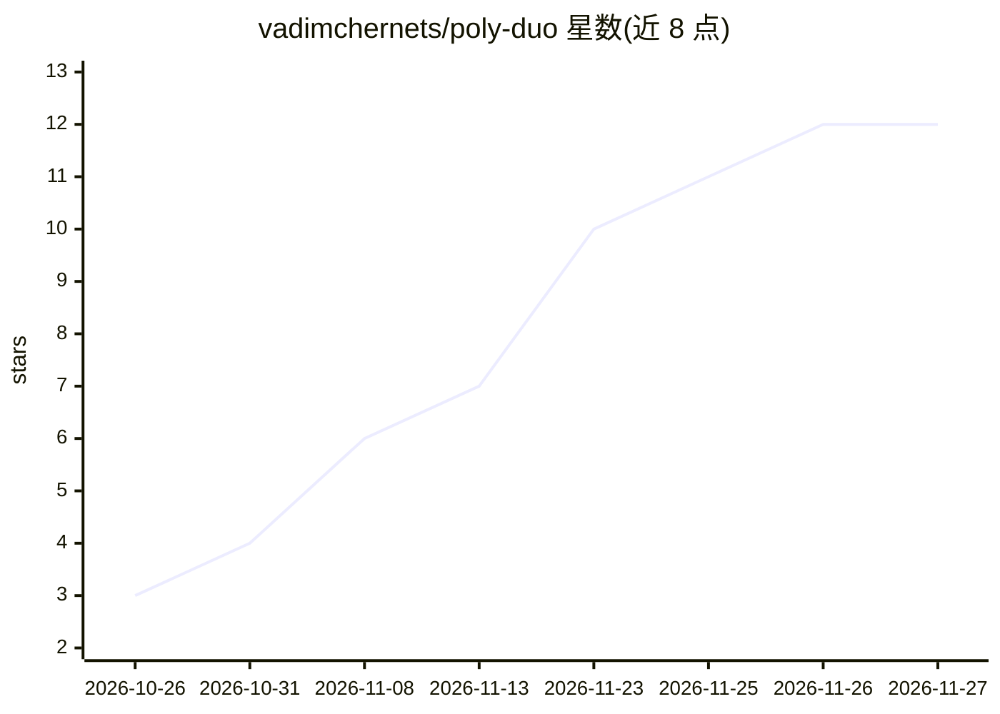

# vadimchernets/poly-duo

⭐ 12 · Python · Apache-2.0 · 推送 2026-11-26 · [GitHub](https://github.com/vadimchernets/poly-duo) · [官网](https://polyhelper.ai/duo) · 个人维护

**让手机上已有 ChatGPT 与 Claude 应用一键协同回答并互查**

Poly Duo 是一组开源 Apple Shortcuts（另有 Android 版）：调用 ChatGPT 与 Claude 应用各自发布的 App Intents（Ask ChatGPT / Ask Claude），同一问题分别向两方提问，再以 Critique 模式让一方审查另一方草稿并对比答案，结果展示在屏幕并写入剪贴板。全程在用户自己的账号与免费套餐内运行，不经作者服务器、无需 API key。限制：仅 iOS 18+（Android 另行分发）、一次运行约一分钟、离开 Shortcuts 或锁屏可能中断、无法在 Duo 内选模型、超长问题可能超时返回空结果。

## 筛选速览

| 维度 | 判定 | 备注 |
|---|---|---|
| AI 角色 | `ai-native` | 本体是模型或模型工具 |
| 许可风险 | `permissive` | Apache-2.0 |
| 部署形态 | `desktop` | 安装包/桌面程序 |
| 模型依赖 | — | README 未给出锁定关系 |
| 硬件要求 | — | 无带数字的原话,不猜 |
| 安装摩擦 | `low` | 无编译、无系统依赖或容器化 |
| 成熟度 | `idea` | |

## 能力要点

- 通过 App Intents 链接 ChatGPT 与 Claude，无自有服务器、无需 API key
- Critique 模式：一方起草、另一方审查并对比答案
- 支持 12 种语言的签名 Shortcut，附 SHA256 校验与 tools/verify.py 验证脚本
- 附免费课堂课程（CC BY 4.0，发布于 OER Commons 与 MERLOT）

## 适用场景

- 用已有的免费 ChatGPT/Claude 账号获得互相核验的第二意见
- 对事实性问题比较两个模型的回答是否一致
- 在课堂上让学生对比两个 AI 聊天机器人的分歧点

## 场景标签

`多智能体` · 领域:Agent 开发

## 证据(README 行号)

> L64: On iPhone, a Shortcut calls Ask ChatGPT, then Ask Claude — actions the two apps publish themselves. Answers pass be
> L66: **What it is, technically:** a signed Apple Shortcut that chains the Ask ChatGPT and Ask Claude App Intents; it mak
> L85: - **iPhone only, iOS 18 or later.** iPad is expected to work on iPadOS 18+, but it is untested.

## 星数曲线

2026-10-26 3 → 2026-11-27 12（+9）

---
*卡片 v1 · prompt 1.4 · 生成 2026-11-23 · 置信度 high · 依据 README sha `7ed9fb720b28` · [字段定义](../../DATASET.md)*
