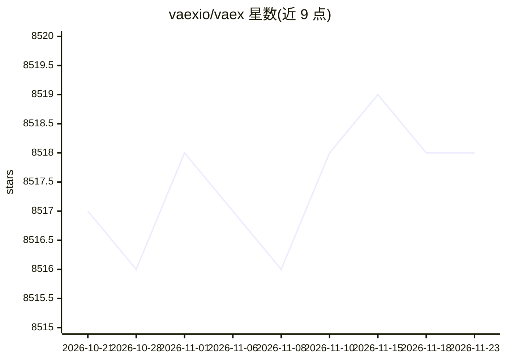

# vaexio/vaex

⭐ 8,518 · Python · MIT · 推送 2026-11-06 · [GitHub](https://github.com/vaexio/vaex) · [官网](https://vaex.io) · 组织维护

**给数据科学家处理十亿行级表格数据的 Python Out-of-Core DataFrame 库**

Vaex 是用于懒加载 Out-of-Core DataFrame 的 Python 库，可对十亿行以上的表格数据集做统计计算与交互式探索，统计量（均值、求和、计数、标准差等）在 N 维网格上每秒可处理十亿样本。关键机制包括内存映射、零内存拷贝与懒计算；支持 HDF5 与 Apache Arrow 格式读取、S3 懒流式读取、表达式系统、并行 groupby/聚合与高效 join，并可集成 Jupyter/Voila 及配合 Scikit-Learn 做机器学习训练。通过 pip 或 conda 安装。

## 筛选速览

| 维度 | 判定 | 备注 |
|---|---|---|
| AI 角色 | `ai-ecosystem` | LLM/agent 周边工具 |
| 许可风险 | `permissive` | MIT |
| 部署形态 | `library` | 以包/库形式分发 |
| 模型依赖 | — | README 未给出锁定关系 |
| 硬件要求 | — | 无带数字的原话,不猜 |
| 安装摩擦 | `low` | 无编译、无系统依赖或容器化 |
| 成熟度 | — | 结构信号不足 |

## 能力要点

- 内存映射 + 懒计算 + 零拷贝的 Out-of-Core DataFrame
- 支持 HDF5/Apache Arrow 读取与 S3 懒流式访问
- 并行化 groupby/聚合与不物化右表的 join
- 集成 Jupyter/Voila，提供无显式 pipeline 的机器学习路径

## 适用场景

- 在笔记本上探索和分析几十 GB 的表格数据
- 对十亿行数据集做快速统计、分组聚合与 join
- 把 CSV/Pandas 数据转换为 HDF5/Arrow 后高效处理
- 配合 Scikit-Learn 在大数据集上做机器学习

## 场景标签

 · 领域:数据科学/大数据处理

## 证据(README 行号)

> L7: Vaex is a high performance Python library for lazy **Out-of-Core DataFrames**
> L66:  * Machine Learning without (explicit) pipelines

## 星数曲线

2026-10-21 8,517 → 2026-11-23 8,518（+1）

---
*卡片 v1 · prompt 1.4 · 生成 2026-11-22 · 置信度 mid · 依据 README sha `ff124e799a2a` · [字段定义](../../DATASET.md)*
