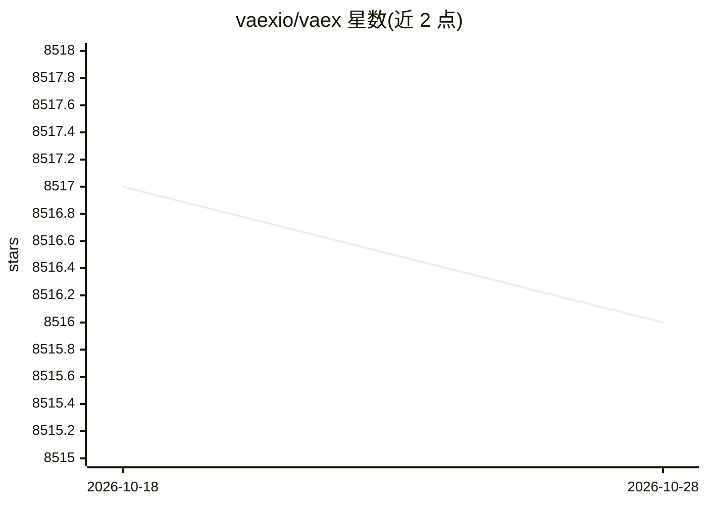

# vaexio/vaex

⭐ 8,516 · Python · MIT · 推送 2026-04-01 · [GitHub](https://github.com/vaexio/vaex) · [官网](https://vaex.io) · 组织维护

**面向十亿行级表格数据的 Python 核外 DataFrame 与可视化库**

Python 库，提供类似 Pandas 的懒计算核外（Out-of-Core）DataFrame，通过内存映射、零拷贝与延迟计算处理大规模表格数据，支持 HDF5 与 Apache Arrow 格式即时打开、S3 懒流式读取、并行 groupby 与省内存 join，并以直方图、密度图和 3D 体渲染支持交互式探索；可集成 Jupyter/Voila，支持无需显式管道的机器学习。面向需要在单机处理大数据的数据科学工作者，安装提供 pip 与 conda-forge 两种方式。

## 筛选速览

| 维度 | 判定 | 备注 |
|---|---|---|
| AI 角色 | `ai-enhanced` | 去掉 AI 部分产品仍成立 |
| 许可风险 | `permissive` | MIT |
| 部署形态 | `library` | 以包/库形式分发 |
| 模型依赖 | — | README 未给出锁定关系 |
| 硬件要求 | — | 无带数字的原话,不猜 |
| 安装摩擦 | `low` | 无编译、无系统依赖或容器化 |
| 成熟度 | — | 结构信号不足 |

## 能力要点

- 内存映射即时打开 HDF5/Apache Arrow 大文件，数据保留在磁盘按需流式读取
- 并行 groupby（类别场景下每秒超 10 亿行）与不物化右表的省内存 join
- 直方图、密度图与 3D 体渲染的交互式大数据可视化
- S3 懒流式读取与 Jupyter/Voila 集成

## 适用场景

- 在笔记本上分析超过 100GB 的表格数据
- 对十亿行级数据做统计计算与交互式可视化探索
- 结合 Scikit-Learn 在单机训练大样本机器学习模型

## 场景标签

 · 领域:数据处理/数据科学

## 证据(README 行号)

> L7: Vaex is a high performance Python library for lazy **Out-of-Core DataFrames**
> L66:  * Machine Learning without (explicit) pipelines

## 星数曲线

2026-10-18 8,517 → 2026-10-28 8,516（-1）

---
*卡片 v1 · prompt 1.4 · 生成 2026-10-20 · 置信度 high · 依据 README sha `e848551da29d` · [字段定义](../../DATASET.md)*
