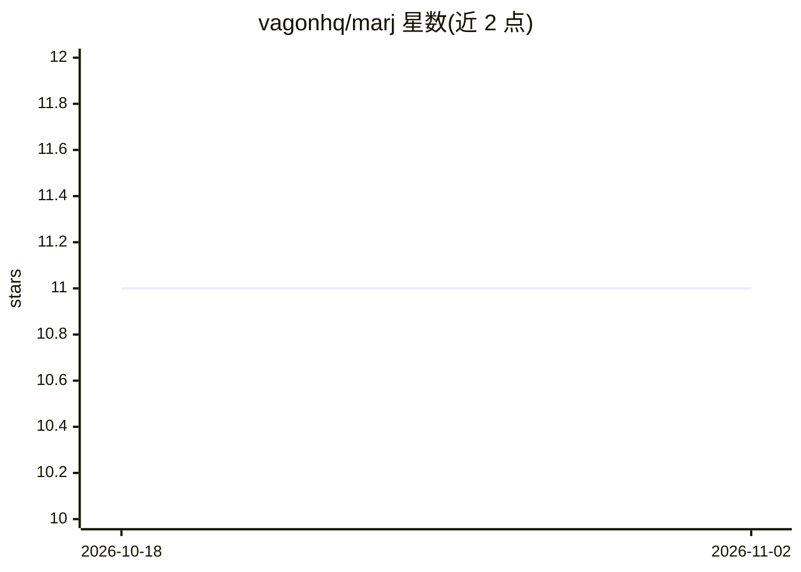

# vagonhq/marj

⭐ 11 · TypeScript · MIT · 推送 2026-10-02 · [GitHub](https://github.com/vagonhq/marj) · 组织维护

**给开发者的本地 git diff 审查 UI：在 diff 里与 Claude Code 会话对话**

面向 Claude Code 用户的本地代码审查工具：以 CLI 启动本地服务器并在浏览器呈现 GitHub 风格的 diff 界面，支持行级/文件级评论、PR 与 merge-base diff、可展开上下文。评论通过线程送达打开它的 Claude Code 会话，可要求 Claude 回答或修改代码；修改以未提交变更形式落回本地仓库，由用户决定提交。单一 hub 进程绑定 127.0.0.1:4711 服务多个仓库审查，状态存于 ~/.marj 下。需要 Node ≥ 20；无云端、无独立 agent。

## 筛选速览

| 维度 | 判定 | 备注 |
|---|---|---|
| AI 角色 | `ai-ecosystem` | LLM/agent 周边工具 |
| 许可风险 | `permissive` | MIT |
| 部署形态 | `library` | 以包/库形式分发 |
| 模型依赖 | — | README 未给出锁定关系 |
| 硬件要求 | — | 无带数字的原话,不猜 |
| 安装摩擦 | `low` | 无编译、无系统依赖或容器化 |
| 成熟度 | — | 结构信号不足 |

## 能力要点

- GitHub 风格本地 diff 界面，行级与文件级评论线程随代码移动重新锚定
- 评论直连打开它的 Claude Code 会话，支持 Comment 与 Comment & fix 两种意图
- 一个 hub（127.0.0.1:4711）同时服务多仓库/多 worktree 审查，含 HTTP API 与 SSE
- 修复以未提交变更落回本地仓库，marj 不会自行 commit 或 push

## 适用场景

- 在本地 diff 界面逐行审查改动并让 Claude 当场解释或修复
- 以 PR 视角审查分支或拉取远程 PR 到本地克隆中评审
- 同时审查多个仓库或 worktree 并在会话间切换

## 场景标签

`代码审查` · 领域:编码与开发

## 证据(README 行号)

> L5: Review your local git changes in a GitHub-style UI — and talk to the Claude Code session that opened it, right in th
> L7: Comment on a line. Claude answers **in that thread**, fixes the code if you asked, and the diff updates under you. N
> L59: marj works on a **local clone**. Open Claude Code (or run `marj`) anywhere inside the repo — any

## 星数曲线

2026-10-18 11 → 2026-11-02 11（+0）

---
*卡片 v1 · prompt 1.4 · 生成 2026-11-01 · 置信度 high · 依据 README sha `90a7806a2634` · [字段定义](../../DATASET.md)*
