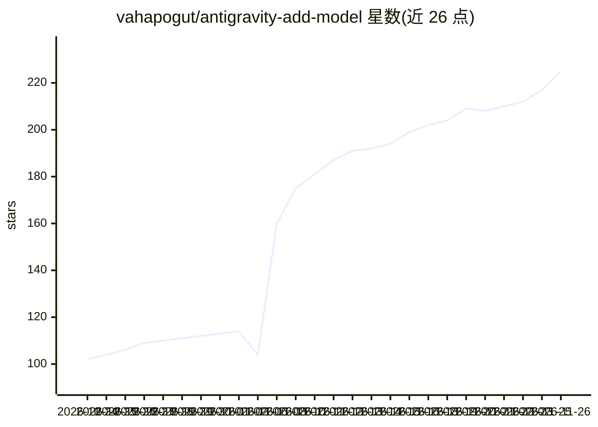

# vahapogut/antigravity-add-model

⭐ 225 · TypeScript · Apache-2.0 · 推送 2026-11-11 · [GitHub](https://github.com/vahapogut/antigravity-add-model) · [官网](https://ipeclabs.com) · 个人维护

**为 Antigravity 添加自定义/本地模型接入的代理补丁**

对 Google Antigravity 桌面应用与 IDE 的补丁工具：拦截内部 Cloud Code API，使其可在设置中添加 OpenAI、Anthropic、Gemini、OpenRouter 等托管 API 以及 Ollama、LM Studio、vLLM 等本地服务，通过聊天选择器切换模型。可选网关提供请求路由、回退链、历史记录与浏览器仪表盘；安装器保留版本备份并支持回滚。需 Node.js 22.13+ 从源码构建，Windows 部分语言服务器需可选二进制补丁。

## 筛选速览

| 维度 | 判定 | 备注 |
|---|---|---|
| AI 角色 | `ai-ecosystem` | LLM/agent 周边工具 |
| 许可风险 | `permissive` | Apache-2.0 |
| 部署形态 | `None` |  |
| 模型依赖 | local-ok | 支持本地模型 |
| 硬件要求 | — | 无带数字的原话,不猜 |
| 安装摩擦 | `low` | 无编译、无系统依赖或容器化 |
| 成熟度 | — | 结构信号不足 |

## 能力要点

- 拦截 Antigravity 内部 Cloud Code API，接入自定义模型提供方
- 支持本地服务（Ollama/LM Studio/llama.cpp/vLLM 等）与托管 API 预设目录
- 可选网关：请求路由、回退链、会话历史与浏览器仪表盘
- 安装器保留版本备份并支持失败回滚

## 适用场景

- 在 Antigravity 中使用自己的 API key 接入 OpenAI/Claude/Gemini
- 把本地 Ollama/vLLM 模型接入 Antigravity 聊天
- 多 Google 账号池管理配额与回退
- 通过网关仪表盘查看请求历史与费用估算

## 场景标签

`模型网关` · 领域:Agent 开发

## 证据(README 行号)

> L20: Add external API providers and local models alongside Antigravity's built-in models. Configure them in Settings, sw
> L41: |**Connect your providers**|OpenAI, Anthropic, Gemini, OpenRouter, Cloudflare Workers AI, and other compatible APIs
> L91: ## Installation

## 星数曲线

2026-10-24 102 → 2026-11-26 225（+123）

---
*卡片 v1 · prompt 1.4 · 生成 2026-11-25 · 置信度 high · 依据 README sha `2515c71d0857` · [字段定义](../../DATASET.md)*
