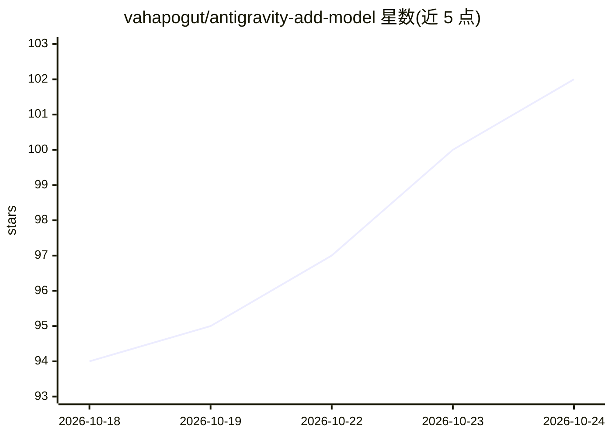

# vahapogut/antigravity-add-model

⭐ 104 · TypeScript · Apache-2.0 · 推送 2026-10-24 · [GitHub](https://github.com/vahapogut/antigravity-add-model) · [官网](https://ipeclabs.com) · 个人维护 · 中文 README

**为 Google Antigravity IDE/桌面端接入自定义 LLM 提供商的补丁与网关**

面向 Google Antigravity 桌面应用与 VS Code 版 Antigravity IDE 的 Node.js 补丁项目：通过拦截内部 Cloud Code API，使用户可在设置中添加 OpenAI、Anthropic、Gemini、OpenRouter 及 Ollama/vLLM 等本地服务，并在聊天选择器中切换模型。安装需 git clone 源码并以 npm 构建后运行 deploy 脚本打补丁，保留版本备份与回滚；另提供可选网关（请求历史、fallback、浏览器面板）。已声明在 Windows IDE 2.5.5 上验证过部分流程。

## 筛选速览

| 维度 | 判定 | 备注 |
|---|---|---|
| AI 角色 | `ai-ecosystem` | LLM/agent 周边工具 |
| 许可风险 | `permissive` | Apache-2.0 |
| 部署形态 | `None` |  |
| 模型依赖 | local-ok | 支持本地模型 |
| 硬件要求 | — | 无带数字的原话,不猜 |
| 安装摩擦 | `low` | 无编译、无系统依赖或容器化 |
| 成熟度 | — | 结构信号不足 |

## 能力要点

- 通过代理补丁为 Antigravity 添加外部 API 与本地模型支持
- 支持 OpenAI/Anthropic/Gemini/OpenRouter 等托管 API 与 Ollama/LM Studio/vLLM/llama.cpp 等本地服务
- 可选网关提供请求历史、fallback 链、成本估算与浏览器面板
- 安装器保留版本备份并支持失败回滚

## 适用场景

- 在 Antigravity IDE 中使用自有 API 或本地模型替代内置模型
- 为多个提供商与 fallback 链做集中路由管理
- 通过网关远程连接并查看请求历史

## 场景标签

`模型网关` · 领域:Agent 开发

## 证据(README 行号)

> L20: Add external API providers and local models alongside Antigravity's built-in models. Configure them in Settings, sw
> L41: |**Connect your providers**|OpenAI, Anthropic, Gemini, OpenRouter, Cloudflare Workers AI, and other compatible APIs
> L53: The installer preserves the installed application's runtime and adds validated hooks. It keeps version-specific bac

## 星数曲线

2026-10-18 94 → 2026-10-24 102（+8）

---
*卡片 v1 · prompt 1.4 · 生成 2026-10-23 · 置信度 high · 依据 README sha `7e2698af4e42` · [字段定义](../../DATASET.md)*
