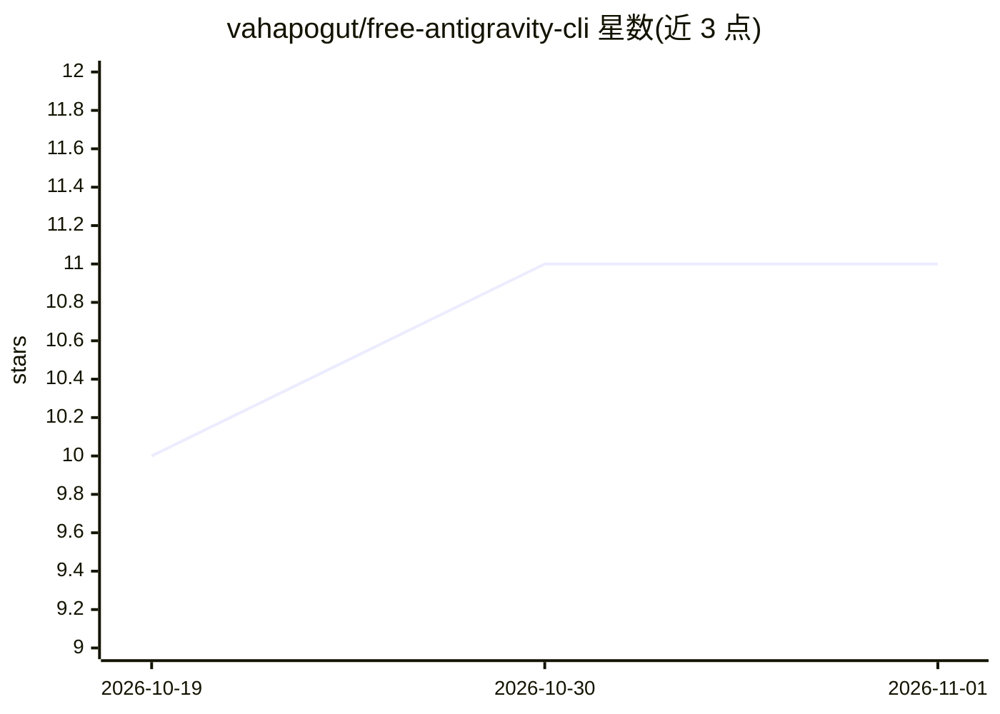

# vahapogut/free-antigravity-cli

⭐ 11 · TypeScript · Apache-2.0 · 推送 2026-05-25 · [GitHub](https://github.com/vahapogut/free-antigravity-cli) · [官网](https://www.npmjs.com/package/free-antigravity-cli) · 个人维护

**为官方 Antigravity CLI 接入自定义 AI 模型的本地代理包装器**

npm 分发的 CLI 工具，包装官方 Antigravity CLI（agy）：启动本地 HTTP 代理（端口 50998），对 agy 二进制做运行时补丁，把 googleapis.com 请求重定向到代理，从而在 agy 原生模型列表中注入自定义模型，并在 Gemini 与 OpenAI、Anthropic、Ollama、OpenRouter、Google AI Studio 等格式间做请求/响应/流式翻译。要求先安装官方 agy 并通过 Antigravity Desktop 完成 Google 账号登录，补丁失败时自动回滚版本化备份。

## 筛选速览

| 维度 | 判定 | 备注 |
|---|---|---|
| AI 角色 | `ai-ecosystem` | LLM/agent 周边工具 |
| 许可风险 | `permissive` | Apache-2.0 |
| 部署形态 | `desktop` | 安装包/桌面程序 |
| 模型依赖 | local-ok | 支持本地模型 |
| 硬件要求 | — | 无带数字的原话,不猜 |
| 安装摩擦 | `low` | 无编译、无系统依赖或容器化 |
| 成熟度 | — | 结构信号不足 |

## 能力要点

- 本地代理拦截 fetchAvailableModels 并注入自定义模型到模型列表与 agentModelSorts
- 支持 OpenAI、Anthropic、Ollama、OpenRouter、DeepSeek、Groq 等 16 类 provider 及任意 OpenAI 兼容端点
- 更新弹性二进制补丁：运行时 URL 发现、空字节填充、版本化备份与自动回滚
- macOS 上自动 ad-hoc 重签名并清除隔离标记

## 适用场景

- 在原生 agy CLI 体验中使用 OpenAI、Claude、本地 Ollama 等自定义模型
- 让 Antigravity CLI 的请求路由到自选 provider 并做格式翻译
- Google 更新 agy 后依赖自动补丁与回滚机制保持可用

## 场景标签

`模型网关` · 领域:Agent 开发

## 证据(README 行号)

> L7: **Open Source Community Edition** — Wraps the official Antigravity CLI (`agy`) with custom AI model support.
> L30: The CLI is a thin wrapper: it starts a local HTTP proxy that intercepts `fetchAvailableModels` API calls, injects y

## 星数曲线

2026-10-19 10 → 2026-11-01 11（+1）

---
*卡片 v1 · prompt 1.4 · 生成 2026-11-01 · 置信度 high · 依据 README sha `936088788123` · [字段定义](../../DATASET.md)*
