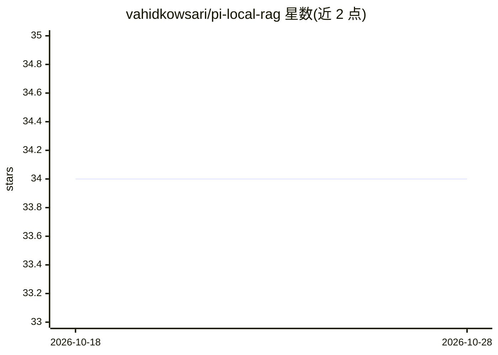

# vahidkowsari/pi-local-rag

⭐ 34 · TypeScript · MIT · 推送 2026-10-21 · [GitHub](https://github.com/vahidkowsari/pi-local-rag) · 个人维护

**Pi coding agent 的本地混合 RAG 扩展：索引本地文件供检索**

面向 Pi coding agent 的扩展，将本地文件（文本/代码/Markdown/JSON/YAML/PDF/DOCX/HTML）分块、用本地 ONNX 模型 Xenova/all-MiniLM-L6-v2（384 维）嵌入并存入 SQLite，检索时以 FTS5 BM25 与 sqlite-vec 余弦相似度混合打分（默认 alpha=0.4），可在每轮对话前自动注入相关片段，索引超过 24 小时后台增量刷新。零云依赖、完全离线运行；OCR 回退需系统安装 poppler 与 tesseract（可选）。提供 /rag 系列命令与 rag_index/rag_query/rag_status 三个 agent 工具。

## 筛选速览

| 维度 | 判定 | 备注 |
|---|---|---|
| AI 角色 | `ai-ecosystem` | LLM/agent 周边工具 |
| 许可风险 | `permissive` | MIT |
| 部署形态 | `None` |  |
| 模型依赖 | — | README 未给出锁定关系 |
| 硬件要求 | — | 无带数字的原话,不猜 |
| 安装摩擦 | `low` | 无编译、无系统依赖或容器化 |
| 成熟度 | — | 结构信号不足 |

## 能力要点

- BM25 + 向量余弦混合检索（SQLite FTS5 + sqlite-vec，权重可配）
- 本地 ONNX 嵌入模型，零云依赖、完全离线
- 每轮对话前自动注入相关片段（KV-cache 友好），24 小时过期自动增量刷新
- 注册 rag_index/rag_query/rag_status 三个供 agent 直接调用的工具

## 适用场景

- 在 Pi coding agent 中检索本地代码库与文档作为上下文
- 离线环境下为编码助手补充项目知识
- 按项目目录建立并自动维护本地索引

## 场景标签

`RAG` · 领域:知识与检索

## 证据(README 行号)

> L3: Local hybrid RAG pipeline for the Pi coding agent. Index your local files and search them with BM25 + vector similar
> L71: The extension registers three tools the agent can call directly:

## 星数曲线

2026-10-18 34 → 2026-10-28 34（+0）

---
*卡片 v1 · prompt 1.4 · 生成 2026-10-25 · 置信度 high · 依据 README sha `c88c70041d7a` · [字段定义](../../DATASET.md)*
