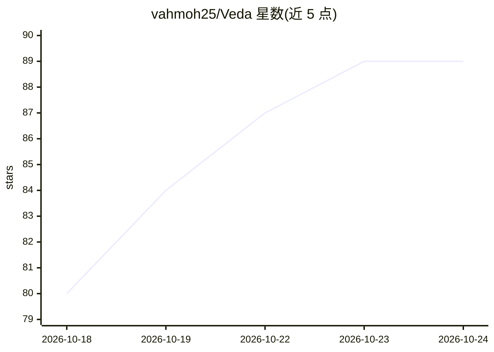

# vahmoh25/Veda

⭐ 89 · Rust · GPL-3.0 · 推送 2026-10-21 · [GitHub](https://github.com/vahmoh25/Veda) · [官网](https://www.vedaos.org) · 个人维护

**Rust 编写的桌面操作系统，内置系统级语音 Agent**

用 Rust 从 UEFI 引导、微内核到窗口系统与应用完整实现的 x86-64 桌面操作系统，通过 QEMU 或 UEFI USB 启动运行。内置开机即起的语音 Agent：应用声明带风险分级的类型化动作，经与键鼠同一代码路径执行，敏感/不可逆操作需用户授权；Linux 驱动运行在自带 hypervisor 的虚拟机中并由 IOMMU 隔离。包含桌面应用套件与 WebKit 浏览器，需自行编译工具链与系统镜像。

## 筛选速览

| 维度 | 判定 | 备注 |
|---|---|---|
| AI 角色 | `ai-enhanced` | 去掉 AI 部分产品仍成立 |
| 许可风险 | `viral` | GPL-3.0 |
| 部署形态 | `None` |  |
| 模型依赖 | — | README 未给出锁定关系 |
| 硬件要求 | — | 无带数字的原话,不猜 |
| 安装摩擦 | `high` | 编译与系统依赖俱全 |
| 成熟度 | — | 结构信号不足 |

## 能力要点

- 语音 Agent 开机即服务，经键鼠同一代码路径驱动应用内 100+ 动作
- 敏感与破坏性操作由系统持有直至用户授权
- 全 Rust 实现：UEFI 引导、微内核、窗口系统与应用
- Linux 驱动运行于自带 hypervisor 的 VM，由 IOMMU 约束并可自动重启

## 适用场景

- 在 QEMU 中编译并体验带系统级语音 Agent 的桌面 OS
- 通过语音让 Agent 操作照片、音乐、文本编辑器等内置应用
- 制作 USB live 系统在实机 UEFI 模式启动体验

## 场景标签

 · 领域:操作系统/桌面环境

## 证据(README 行号)

> L5: An operating system written in Rust, with a voice agent built into the system.
> L15: Say *"Hey Veda, switch my wallpaper to the dunes"* and it is done. The agent
> L21:  An agent in the system A service from boot that wakes when you say its name. Its model, its voice and even its nam

## 星数曲线

2026-10-18 80 → 2026-10-24 89（+9）

---
*卡片 v1 · prompt 1.4 · 生成 2026-10-23 · 置信度 high · 依据 README sha `8e30643c5d5f` · [字段定义](../../DATASET.md)*
