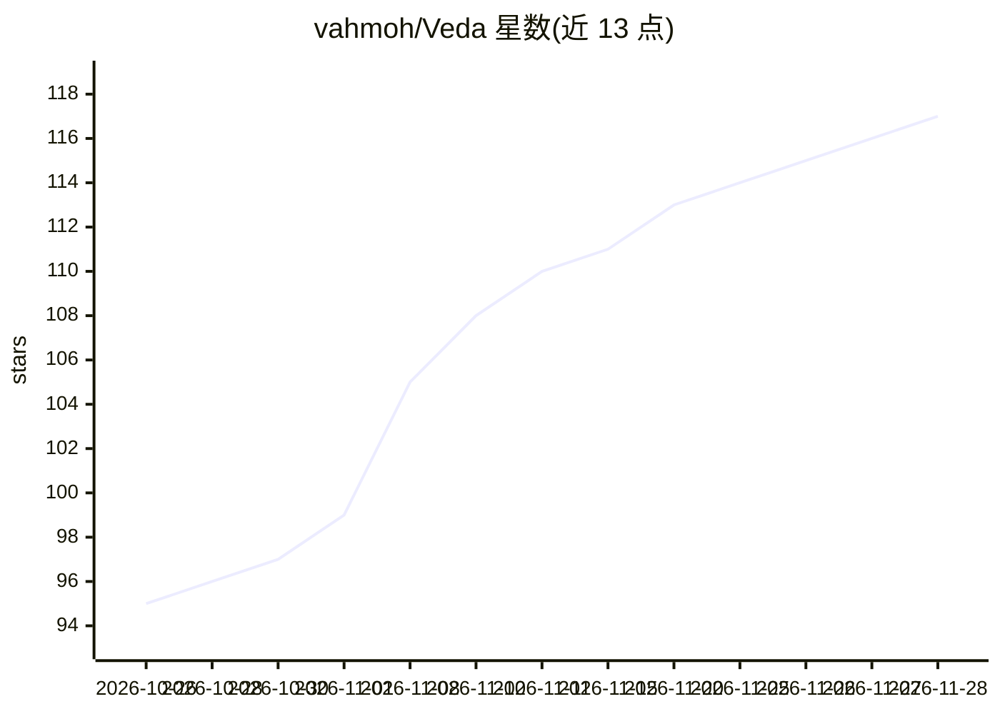

# vahmoh/Veda

⭐ 117 · Rust · GPL-3.0 · 推送 2026-11-27 · [GitHub](https://github.com/vahmoh/Veda) · [官网](https://www.vedaos.org) · 个人维护

**内置语音 Agent 的 Rust 编写实验性桌面操作系统**

以 Rust 从 UEFI 引导、微内核到窗口系统与应用栈实现的操作系统，运行于 QEMU（x86-64/ARM64）与实体 x86-64 PC。系统内置从开机即运行的语音 Agent，通过唤醒词触发，模型、语音与名称可配置；应用以类型化 action 声明供 Agent 操作，敏感与破坏性操作需用户同意。采用能力微内核、用户态服务自动重启、Linux 以驱动 VM 方式提供硬件驱动。构建依赖 KVM 与 QEMU 等工具链，语音识别依赖 Deepgram API key。

## 筛选速览

| 维度 | 判定 | 备注 |
|---|---|---|
| AI 角色 | `ai-enhanced` | 去掉 AI 部分产品仍成立 |
| 许可风险 | `viral` | GPL-3.0 |
| 部署形态 | `None` |  |
| 模型依赖 | — | README 未给出锁定关系 |
| 硬件要求 | — | 无带数字的原话,不猜 |
| 安装摩擦 | `high` | 编译与系统依赖俱全 |
| 成熟度 | — | 结构信号不足 |

## 能力要点

- 内置系统级语音 Agent，操作与键鼠同一代码路径
- 应用声明类型化 action，内置应用提供 100+ 可操作项
- Rust 微内核 + 用户态服务自重启 + Linux 驱动 VM（IOMMU 隔离）
- GPL-3.0-only，提供 make an app agentic 的 ui 工具包接口

## 适用场景

- 在 QEMU 中体验 Agent 原生的桌面环境
- 通过语音指令完成换壁纸、放音乐、删除照片等系统操作
- 以 Rust 开发可被 Agent 调用的桌面应用

## 场景标签

`语音 Agent` · 领域:对话与助手

## 证据(README 行号)

> L3: **The Agentic-Native Operating System**
> L5: An operating system written in Rust, with a voice agent built into the system.
> L15: Say *"Hey Veda, switch my wallpaper to the dunes"* and it is done. The agent
> L22:  Actions, not screen scraping Applications declare typed actions that run the same code as the keyboard and mouse. 

## 星数曲线

2026-10-26 95 → 2026-11-28 117（+22）

---
*卡片 v1 · prompt 1.4 · 生成 2026-11-28 · 置信度 high · 依据 README sha `c1dfcf9e2062` · [字段定义](../../DATASET.md)*
