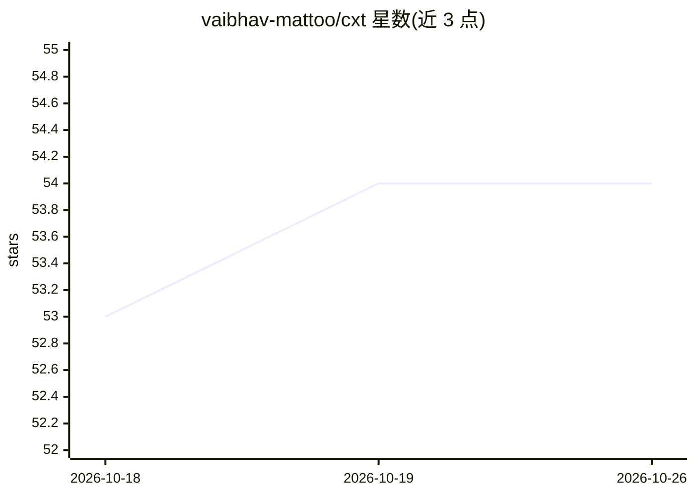

# vaibhav-mattoo/cxt

⭐ 54 · Rust · MIT · 推送 2026-08-28 · [GitHub](https://github.com/vaibhav-mattoo/cxt) · [官网](https://github.com/vaibhav-mattoo/cxt) · 个人维护

**将代码文件聚合为剪贴板上下文块的 Rust CLI，供 AI 助手使用**

Rust 编写的命令行/TUI 工具，把多个文件与目录聚合为单一上下文块并复制到剪贴板，默认输出带 <file path> 标签的 XML 格式（可选 Markdown）。面向需要向 ChatGPT 等 Web AI 助手投喂代码的开发者。支持语言/扩展名过滤、glob 忽略规则、gzip 压缩输出、隐藏文件包含；提供 TUI 交互式文件选择（模糊搜索、vim 风格键位）。二进制文件自动检测并跳过。安装途径含安装脚本、cargo、Homebrew、AUR 与源码编译。

## 筛选速览

| 维度 | 判定 | 备注 |
|---|---|---|
| AI 角色 | `ai-ecosystem` | LLM/agent 周边工具 |
| 许可风险 | `permissive` | MIT |
| 部署形态 | `self-host` | docker 或自建部署 |
| 模型依赖 | — | README 未给出锁定关系 |
| 硬件要求 | — | 无带数字的原话,不猜 |
| 安装摩擦 | `low` | 无编译、无系统依赖或容器化 |
| 成熟度 | — | 结构信号不足 |

## 能力要点

- 文件/目录聚合为 XML（默认）或 Markdown 格式的剪贴板上下文块
- 交互式 TUI 文件选择器（模糊搜索、vim 风格键位）
- 按语言/扩展名过滤与可重复的 glob 忽略规则
- 支持 gzip 压缩输出到文件

## 适用场景

- 把项目代码打包后粘贴给 ChatGPT/Perplexity 等 Web AI 助手
- 按语言筛选后提取代码片段生成上下文快照
- 交互式挑选文件后一键复制到剪贴板

## 场景标签

 · 领域:开发者工具/AI 辅助工作流

## 证据(README 行号)

> L9: Aggregate files and directories quickly into a single clipboard-ready context block, tuned for feeding code to AI as
> L55: cxt src/ README.md        # aggregate paths → clipboard

## 星数曲线

2026-10-18 53 → 2026-10-26 54（+1）

---
*卡片 v1 · prompt 1.4 · 生成 2026-10-24 · 置信度 mid · 依据 README sha `c2c365ea6d65` · [字段定义](../../DATASET.md)*
