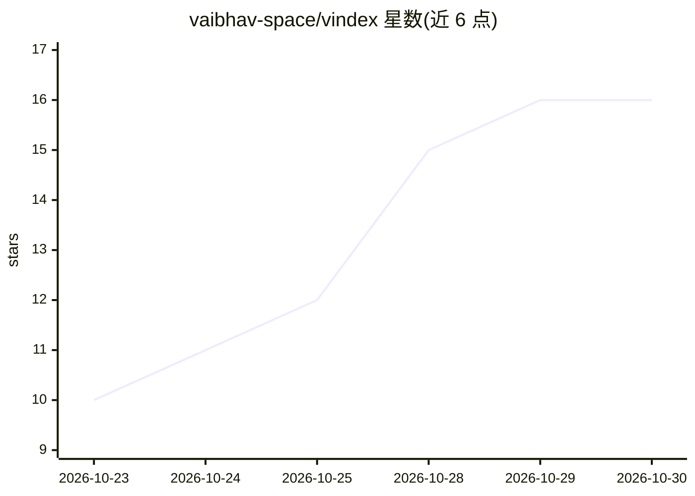

# vaibhav-space/vindex

⭐ 16 · Python · MIT · 推送 2026-07-23 · [GitHub](https://github.com/vaibhav-space/vindex) · [官网](https://vaibhav-space.github.io/vindex/) · 个人维护

**本地视频知识编译器：把视频一次性编译成结构化 JSON/Markdown 供 AI 消费**

面向 AI 工程师与开发者的本地优先 Python SDK/CLI/REST API：通过 faster-whisper 语音识别、PaddleOCR-VL 文字识别、Qwen2-VL 场景描述、PySceneDetect 场景检测等模块化流水线，将视频编译为带版本化 Pydantic schema 的确定性产物（visual_memory.json、timeline、asr、ocr 等），供 RAG/agent 直接消费。全程本机运行、无 API key、输出字节可复现；每个抽取阶段可通过插件接口替换。限制：v0.1.0 预发布、处于积极开发中，默认面向 macOS Apple Silicon，Linux 为 CPU 推理，需 ffmpeg 与约 3.5GB 模型权重。

## 筛选速览

| 维度 | 判定 | 备注 |
|---|---|---|
| AI 角色 | `ai-native` | 本体是模型或模型工具 |
| 许可风险 | `permissive` | MIT |
| 部署形态 | `None` |  |
| 模型依赖 | — | README 未给出锁定关系 |
| 硬件要求 | `cpu-ok` | |
| 安装摩擦 | `medium` | 含编译或系统依赖之一 |
| 成熟度 | `idea` | |

## 能力要点

- 多模态流水线产出 6 类版本化 JSON/Markdown 产物，字节级可复现
- 本地运行、无云端账号与 API key，模型约 3.5GB 下载一次复用
- 插件接口可替换各抽取阶段的模型/运行时
- 提供 CLI、Python SDK、FastAPI REST API 与内置 Web UI

## 适用场景

- 把 visual_memory.json 喂给 RAG 流水线或 LLM 上下文，免去自建视频摄取管线
- 批量索引视频库为纯 JSON 并用标准工具检索与 diff
- 从讲座录像中提取逐字转录、带时间戳的 OCR 与场景结构
- 视频剪辑前程序化获知每个剪辑点、场景与屏幕文字位置

## 场景标签

`语音识别` `OCR` `图像视频处理` `多模态` · 领域:感知与多模态

## 证据(README 行号)

> L14: `vindex` is a local-first, open-source Python SDK and REST API that processes any video file through a modular mult
> L77: |**Speech Recognition**|faster-whisper (medium, 769M params)|CTranslate2-based; 99 languages; auto language detecti
> L79: |**Vision-Language Model**|Qwen2-VL via mlx-vlm|Native Apple Silicon (MLX); unified memory; best RAM-to-quality rat

## 星数曲线

2026-10-23 10 → 2026-10-30 16（+6）

---
*卡片 v1 · prompt 1.4 · 生成 2026-10-30 · 置信度 high · 依据 README sha `08e09968dc84` · [字段定义](../../DATASET.md)*
