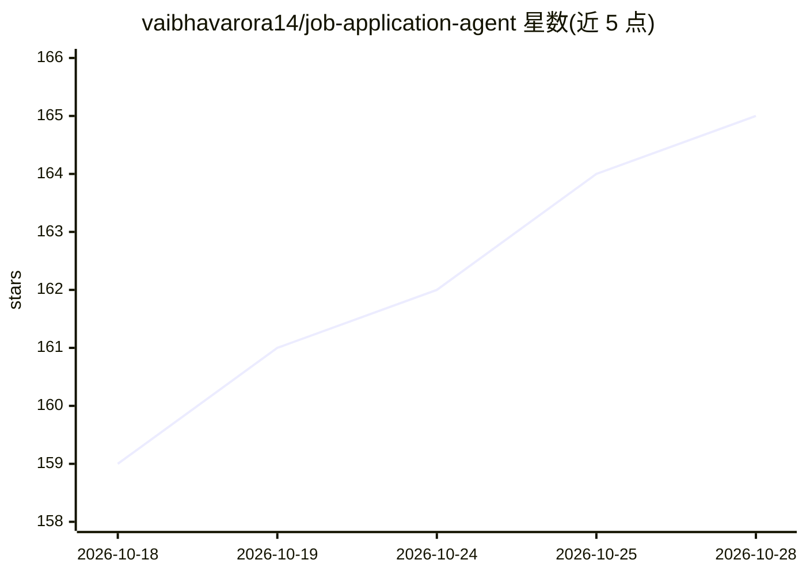

# vaibhavarora14/job-application-agent

⭐ 165 · JavaScript · MIT · 推送 2026-10-26 · [GitHub](https://github.com/vaibhavarora14/job-application-agent) · [官网](https://jobappagent.com) · 个人维护

**给求职者的 Agent 技能与 CLI：搜索、资格判断、按规则投递并追踪申请**

面向个人求职者的开源 Agent Skill 与配套 CLI（Node 20+，npx 安装）：配合具备浏览器能力的编程 agent 使用，覆盖职位发现（共享来源目录 + 雇主端核验）、资格与去重判断、表单填写与简历上传、仅记录确认的投递、结果复盘五个环节。提供 review-each 与 routine-auto 两级自主度，SSO/MFA/法律声明等场景暂停交还用户。CLI 负责档案存储（OS 凭证库）、评分、账本与回合管理；agent 负责发现与浏览器交互。支持 Codex/Claude Code/Cursor 等技能目录，可选 Cloudflare D1 私有云状态同步；默认开启匿名分析与社区共享，可分别关闭。LLM 辅助（Free.ai，OpenAI 兼容端点）为可选。

## 筛选速览

| 维度 | 判定 | 备注 |
|---|---|---|
| AI 角色 | `ai-ecosystem` | LLM/agent 周边工具 |
| 许可风险 | `permissive` | MIT |
| 部署形态 | `library` | 以包/库形式分发 |
| 模型依赖 | — | README 未给出锁定关系 |
| 硬件要求 | — | 无带数字的原话,不猜 |
| 安装摩擦 | `low` | 无编译、无系统依赖或容器化 |
| 成熟度 | — | 结构信号不足 |

## 能力要点

- 单一已验证简历驱动的发现-判断-投递-追踪-改进闭环，仅记录确认的投递
- review-each / routine-auto 两级自主度，密码/SSO/MFA/法律声明场景暂停
- CLI 管理 OS 凭证库档案、评分、去重、可恢复回合与申请/结果账本
- 可选私有 Cloudflare D1 后端跨主机同步状态，单主机租约防重复投递

## 适用场景

- 让编程 agent 按我的规则自动搜索并投递职位申请
- 统一管理我的求职档案、申请记录与结果复盘
- 跨多台设备同步私有求职状态并控制自主度

## 场景标签

`浏览器自动化` · 领域:效率与自动化

## 证据(README 行号)

> L20: Job Application Agent is an Agent Skill that helps a coding agent discover, evaluate, complete, and track your own 
> L143: The bundled CLI handles private profile storage, résumé import, scoring, duplicate checks, resumable rounds, atten

## 星数曲线

2026-10-18 159 → 2026-10-28 165（+6）

---
*卡片 v1 · prompt 1.4 · 生成 2026-10-22 · 置信度 high · 依据 README sha `efa0f3f6dc13` · [字段定义](../../DATASET.md)*
