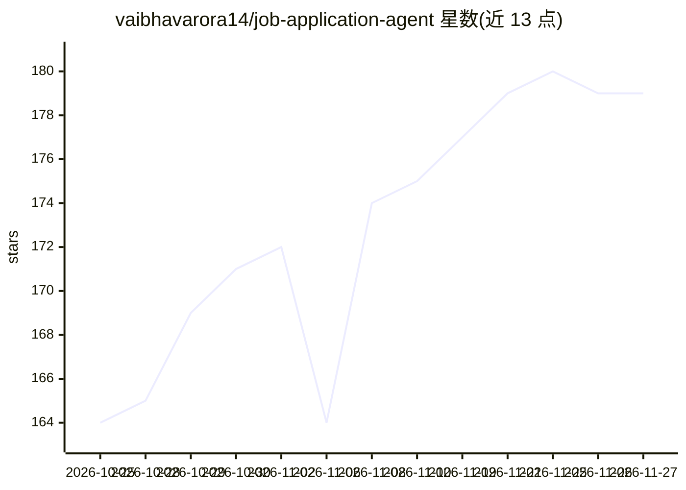

# vaibhavarora14/job-application-agent

⭐ 179 · JavaScript · MIT · 推送 2026-11-26 · [GitHub](https://github.com/vaibhavarora14/job-application-agent) · [官网](https://jobappagent.com) · 个人维护

**AI 求职申请 Agent 技能：搜索职位并按规则代为投递追踪**

以 Agent Skill + CLI 形式分发的求职自动化工具，安装在用户的编码 agent 中运行。流程覆盖 Discover（搜索并核实职位）、Qualify（资历/地点/签证等筛查）、Apply（填写表单并上传一份核验过的简历）、Track（去重并仅记录雇主站点确认的投递）、Improve。默认 review-each 模式在雇主页面填好后在提交前停下由用户确认，可选 opt-in 自动投递；遇到 SSO/MFA/CAPTCHA 等自动暂停。凭据存 OS credential store，可选 Cloudflare D1 跨主机同步。

## 筛选速览

| 维度 | 判定 | 备注 |
|---|---|---|
| AI 角色 | `ai-native` | 本体是模型或模型工具 |
| 许可风险 | `permissive` | MIT |
| 部署形态 | `library` | 以包/库形式分发 |
| 模型依赖 | — | README 未给出锁定关系 |
| 硬件要求 | — | 无带数字的原话,不猜 |
| 安装摩擦 | `low` | 无编译、无系统依赖或容器化 |
| 成熟度 | `idea` | |

## 能力要点

- Discover/Qualify/Apply/Track/Improve 五阶段流程，仅基于一份核验简历填写
- review-each 默认模式：填表后在雇主页面提交前停止，由用户确认
- 自动暂停于密码/SSO/MFA/CAPTCHA/法律声明等场景，不读取 cookie 与 session 文件
- 支持 Hermes Agent/Grok Bot/OpenClaw 模板及 Codex、Claude Code、Cursor 等技能目录

## 适用场景

- 在 Greenhouse/Ashby/Lever 平台上按自己的规则批量投递职位
- 用 ledger 命令追踪投递状态并记录回复/面试/offer 结果
- 多台可信主机间同步简历与申请状态

## 场景标签

`浏览器自动化` `工作流自动化` · 领域:效率与自动化

## 证据(README 行号)

> L20: JobAppAgent (Job Application Agent) is an Agent Skill that helps a coding agent discover, evaluate, complete, and t
> L68: Requires Node.js 20 or newer and a browser-capable coding agent.
> L85: The existing installer also supports Codex, Claude Code, Cursor, Copilot, and

## 星数曲线

2026-10-25 164 → 2026-11-27 179（+15）

---
*卡片 v1 · prompt 1.4 · 生成 2026-11-27 · 置信度 high · 依据 README sha `4018afd63fdb` · [字段定义](../../DATASET.md)*
