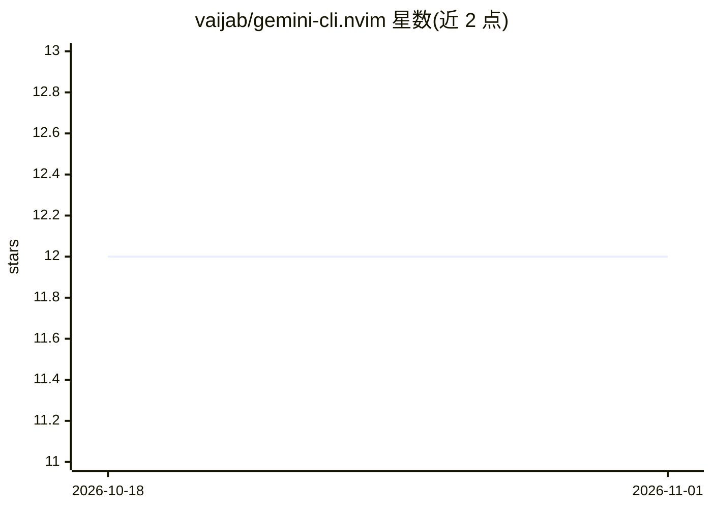

# vaijab/gemini-cli.nvim

⭐ 12 · Lua · MIT · 推送 2026-04-09 · [GitHub](https://github.com/vaijab/gemini-cli.nvim) · 个人维护

**将 Neovim 变为 Gemini CLI 语义后端的 MCP 插件**

Neovim 插件，通过实现 Model Context Protocol（MCP）桥接编辑器与 Gemini CLI agent：把 Neovim 的 LSP 与 Tree-sitter 能力以 MCP 工具形式暴露，提供符号查找、定义解析、引用检索、文件大纲、诊断读取、Tree-sitter 查询等 9 个工具；同时同步打开文件、光标位置与选区作为上下文，代码修改以 Neovim diff split 呈现。面向使用 Gemini CLI 的 Neovim 用户，需 Neovim ≥0.10、Go ≥1.23（构建内部 Go 桥接服务）及全局安装的 Gemini CLI。

## 筛选速览

| 维度 | 判定 | 备注 |
|---|---|---|
| AI 角色 | `ai-ecosystem` | LLM/agent 周边工具 |
| 许可风险 | `permissive` | MIT |
| 部署形态 | `library` | 以包/库形式分发 |
| 模型依赖 | — | README 未给出锁定关系 |
| 硬件要求 | — | 无带数字的原话,不猜 |
| 安装摩擦 | `low` | 无编译、无系统依赖或容器化 |
| 成熟度 | — | 结构信号不足 |

## 能力要点

- 基于 MCP 暴露 LSP/Tree-sitter 语义工具共 9 个
- 实时同步打开文件、光标位置与可视选区给 agent
- 代码变更以 Neovim 原生 diff split 呈现并可接受/拒绝
- 零配置自动管理 MCP 连接

## 适用场景

- 在 Neovim 中让 Gemini CLI agent 语义化浏览我的代码库
- 让 agent 利用 LSP 精确定位定义与引用而非全文 grep
- 通过 diff 工作流审阅 agent 提出的代码修改

## 场景标签

 · 领域:开发工具/编辑器 AI 集成

## 证据(README 行号)

> L5: `gemini-cli.nvim` bridges the gap between your editor and the Gemini CLI agent. It implements the **Model Context Pr
> L73: These tools are exposed to the Gemini agent, allowing it to interact with Neovim's LSP and Tree-sitter engine:

## 星数曲线

2026-10-18 12 → 2026-11-01 12（+0）

---
*卡片 v1 · prompt 1.4 · 生成 2026-10-31 · 置信度 mid · 依据 README sha `50f53afa580c` · [字段定义](../../DATASET.md)*
