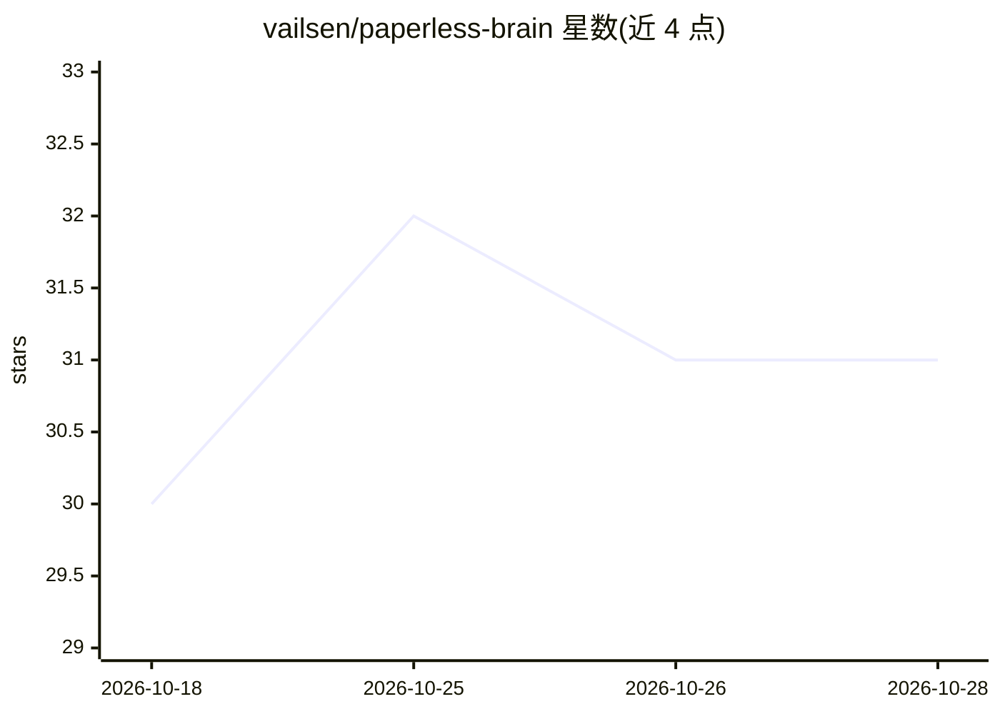

# vailsen/paperless-brain

⭐ 31 · Python · MIT · 推送 2026-10-28 · [GitHub](https://github.com/vailsen/paperless-brain) · [官网](https://github.com/vailsen/paperless-brain#quick-start-docker) · 个人维护

**面向 Paperless-ngx 用户：用本地或云端 LLM 与文档档案对话**

自托管的 Paperless-ngx 前端 AI 应用：通过视觉 LLM 逐页读取归档文档，生成摘要、表格、行动项与截止日期，支持带引用溯源的对话检索、语义搜索（multilingual-e5 + ChromaDB）、Markdown 笔记库、语音备忘、深度研究、文档生成与 AI 命名。模型按用户配置，兼容 Anthropic/OpenAI 兼容端点，本地可经 Ollama 运行。需配合 Paperless-ngx 与视觉模型使用，以 Docker 镜像部署，个人 homelab 项目、单一维护者。

## 筛选速览

| 维度 | 判定 | 备注 |
|---|---|---|
| AI 角色 | `ai-native` | 本体是模型或模型工具 |
| 许可风险 | `permissive` | MIT |
| 部署形态 | `self-host` | docker 或自建部署 |
| 模型依赖 | local-ok | 支持本地模型 |
| 硬件要求 | — | 无带数字的原话,不猜 |
| 安装摩擦 | `low` | 无编译、无系统依赖或容器化 |
| 成熟度 | `idea` | |

## 能力要点

- 视觉 LLM 逐页摄取文档，提取摘要/表格/行动项/截止日期
- 答案带引用编号，点击可跳转 PDF 原文高亮段落
- 按用户配置模型，兼容 Ollama/vLLM 等本地运行时与云端提供商
- Markdown 笔记库、语音备忘、深度研究与 DIN-5008 文档生成

## 适用场景

- 给自托管的 Paperless-ngx 档案加一个可对话的 AI 界面
- 从合同与票据中自动提取截止日期和待办
- 在手机上以 PWA 查询文档并查看原文出处

## 场景标签

`文档问答` `语义搜索` · 领域:知识与检索

## 证据(README 行号)

> L25: Paperless-ngx stores and organizes your documents. PaperlessBrain reads them —
> L29: - **Chat with your archive** — an agentic tool loop that searches, reads,
> L34: - **Vision-LLM ingestion** — every page rendered and read by a vision model:
> L113: |A vision-capable model|for ingestion — local via Ollama (Qwen-VL class, can live on another machine) or any cloud

## 星数曲线

2026-10-18 30 → 2026-10-28 31（+1）

---
*卡片 v1 · prompt 1.4 · 生成 2026-10-26 · 置信度 high · 依据 README sha `7dbf78b18321` · [字段定义](../../DATASET.md)*
