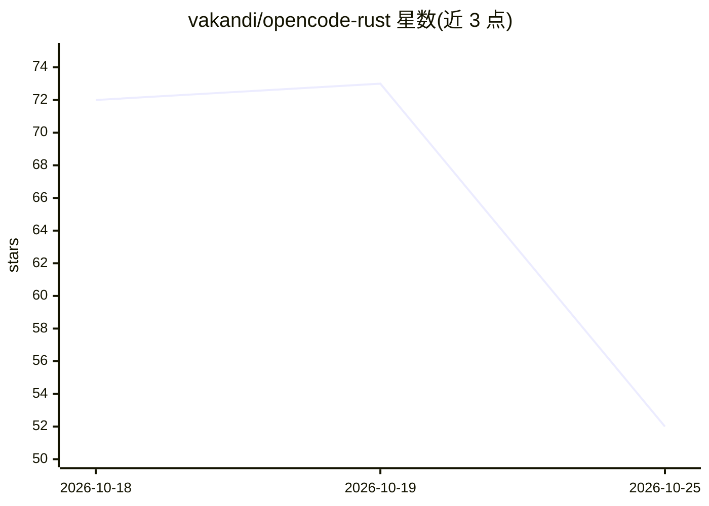

# vakandi/opencode-rust

⭐ 52 · Rust · MIT · 推送 2026-10-24 · [GitHub](https://github.com/vakandi/opencode-rust) · [官网](https://vakandi.github.io/opencode-rust/) · 个人维护

**Rust 实现的开源 AI 编码代理，CLI/TUI/HTTP 服务**

OpenCode 的 Rust 实现，提供 CLI、TUI 与 HTTP server 三种形态，统一在 opr 命令下运行本地 AI 编码代理：会话管理、工具执行、MCP（stdio 并行启动）、LSP 与 Node 插件桥。对话历史落盘 SQLite，工具 schema 按 (model, tool-set) 缓存，实例状态按配置哈希池化并 LRU+TTL 淘汰，无需 Docker 容器。安装途径为 npm（预编译二进制）、Homebrew 或源码；运行需 Node 18+ 与 provider API key。内置 build/plan 两个 agent，另带轮换住宅代理池功能。

## 筛选速览

| 维度 | 判定 | 备注 |
|---|---|---|
| AI 角色 | `ai-native` | 本体是模型或模型工具 |
| 许可风险 | `permissive` | MIT |
| 部署形态 | `self-host` | docker 或自建部署 |
| 模型依赖 | — | README 未给出锁定关系 |
| 硬件要求 | — | 无带数字的原话,不猜 |
| 安装摩擦 | `low` | 无编译、无系统依赖或容器化 |
| 成熟度 | — | 结构信号不足 |

## 能力要点

- CLI/TUI/HTTP server 三形态共享同一引擎， opr 命令分发
- MCP stdio 并行启动（90 秒上限），工具同时暴露给模型并执行
- 对话历史落盘 SQLite、工具 schema 缓存、实例状态 LRU+TTL 淘汰
- 内置轮换代理池：本地 HTTP/CONNECT 转发，120 秒轮换上游出口 IP

## 适用场景

- 在终端里让 AI agent 执行编码、测试修复与仓库分析任务
- 以 HTTP server 形态接入本地 AI agent 供其他客户端调用
- 长时间跑 agent 任务时轮换出口 IP 避免单 IP 被消耗

## 场景标签

`编码 Agent` · 领域:编码与开发

## 证据(README 行号)

> L13:  A Rust implementation of OpenCode — CLI, TUI and HTTP server for
> L14:  local AI agents. Sessions, tool execution, MCP, LSP and a TypeScript plugin bridge, with no

## 星数曲线

2026-10-18 72 → 2026-10-25 52（-20）

---
*卡片 v1 · prompt 1.4 · 生成 2026-10-24 · 置信度 mid · 依据 README sha `8dc6bf294134` · [字段定义](../../DATASET.md)*
