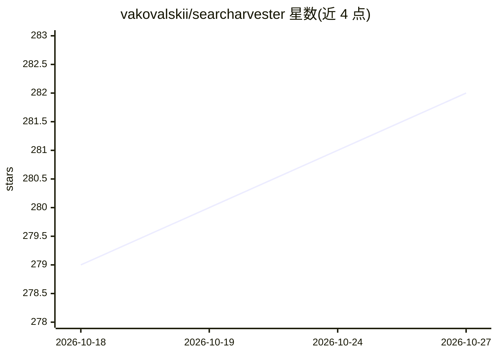

# vakovalskii/searcharvester

⭐ 282 · Python · AGPL-3.0 · 推送 2026-09-30 · [GitHub](https://github.com/vakovalskii/searcharvester) · [官网](https://github.com/vakovalskii/searcharvester) · 个人维护 · 中文 README

**面向 AI agent 的自托管搜索/抽取/深度研究服务**

通过一条 docker compose 命令部署的自托管服务：/search 提供兼容 Tavily schema 的搜索（经 SearXNG 聚合 100+ 引擎，含图片视频），/extract 将 URL 转为清洁 markdown（trafilatura/readability/Defuddle 三抽取器自动择优，带尺寸档位与分页），/research 运行 Hermes Agent 子进程组成的深度研究团队（plan→gather→gap-check→synthesise→verify），产出带引用的 markdown 报告。面向开发者与 AI agent 集成场景，LLM 无关，支持任意 OpenAI 兼容端点，每角色可配不同模型。配套 React Web UI（:9762）可观察各 agent 实时工作、管理引擎/代理/抽取器设置。搜索无 API key，全自托管。

## 筛选速览

| 维度 | 判定 | 备注 |
|---|---|---|
| AI 角色 | `ai-ecosystem` | LLM/agent 周边工具 |
| 许可风险 | `viral` | AGPL-3.0 |
| 部署形态 | `self-host` | docker 或自建部署 |
| 模型依赖 | local-ok | 支持本地模型 |
| 硬件要求 | — | 无带数字的原话,不猜 |
| 安装摩擦 | `low` | 无编译、无系统依赖或容器化 |
| 成熟度 | — | 结构信号不足 |

## 能力要点

- /search 兼容 Tavily schema，经 SearXNG 聚合 100+ 引擎
- /extract 三抽取器自动择优，尺寸档位与分页，缓存 30 分钟
- /research 深度研究团队：quick 单 agent / deep 多角色并行 + critic 与 fact-checker
- 适配器级 loop guard：LLM 调用/token/搜索/读取预算与循环检测

## 适用场景

- 给 AI agent 提供自托管、无配额的搜索与网页抽取 API
- 让多 agent 团队自动产出带引用的深度研究报告
- 在 Web UI 中实时观察研究 agent 的工作过程与来源

## 场景标签

`多智能体` `网页抓取` · 领域:Agent 开发

## 证据(README 行号)

> L3: **Self-hosted search + extract + deep research for AI agents, with a web UI to watch the agents work**
> L9: - **`/search`**: Tavily-compatible search via SearXNG (100+ engines), including images and videos
> L128: LLM-agnostic: any OpenAI-compatible endpoint (OpenAI, OpenRouter, LiteLLM, vLLM, Ollama, LM Studio).

## 星数曲线

2026-10-18 279 → 2026-10-27 282（+3）

---
*卡片 v1 · prompt 1.4 · 生成 2026-10-22 · 置信度 mid · 依据 README sha `74e1cc40db63` · [字段定义](../../DATASET.md)*
