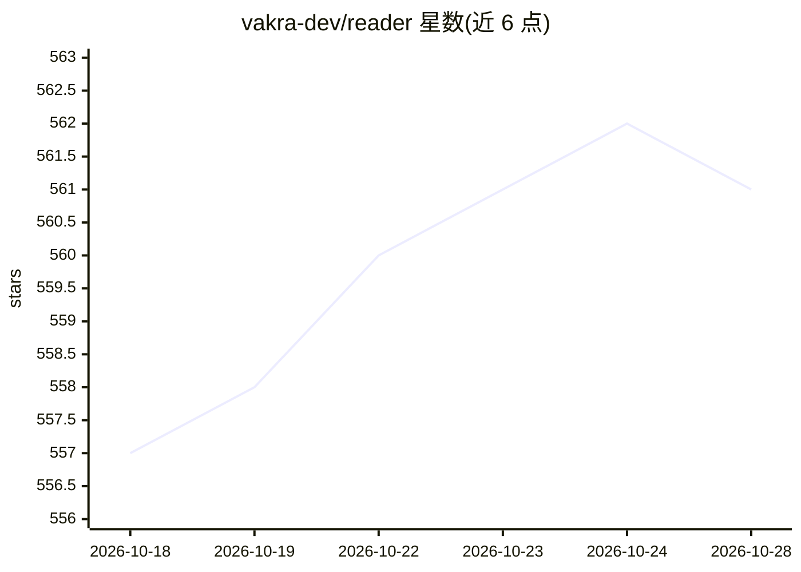

# vakra-dev/reader

⭐ 561 · TypeScript · Apache-2.0 · 推送 2026-10-06 · [GitHub](https://github.com/vakra-dev/reader) · [官网](https://reader.dev) · 个人维护

**给 AI agent 的网页抓取基础设施：反爬浏览器输出干净 markdown**

基于 Playwright 的 TypeScript 网页抓取引擎，面向需要访问网页的 AI agent 开发者。提供 scrape/crawl/browser 三个原语：单页与并发批量抓取并输出自动提取正文的 markdown/HTML，BFS 站点爬取，以及可由 Playwright/Puppeteer 通过 CDP 驱动的隐身浏览器会话。内建浏览器池管理、TLS 指纹、navigator 伪装等反检测机制，支持标准/付费两级代理池与轮换。以 npm 包和 CLI 形式提供，要求 Node.js >= 18，首次运行需安装 Playwright Chromium。

## 筛选速览

| 维度 | 判定 | 备注 |
|---|---|---|
| AI 角色 | `ai-ecosystem` | LLM/agent 周边工具 |
| 许可风险 | `permissive` | Apache-2.0 |
| 部署形态 | `library` | 以包/库形式分发 |
| 模型依赖 | — | README 未给出锁定关系 |
| 硬件要求 | — | 无带数字的原话,不猜 |
| 安装摩擦 | `low` | 无编译、无系统依赖或容器化 |
| 成熟度 | — | 结构信号不足 |

## 能力要点

- scrape/crawl/browser 三原语，输出自动正文提取的 markdown/HTML
- 内建反检测：TLS 指纹、navigator 伪装、WebRTC 遮蔽、webdriver=false
- 浏览器池自动回收与健康监测，标准/付费两级代理池轮换
- 隐身 Chrome 会话通过 CDP 供 Playwright/Puppeteer 驱动

## 适用场景

- 让 AI agent 以干净 markdown 获取网页内容
- 绕过 Cloudflare 等反爬机制抓取目标站点
- 批量并发抓取与全站爬取供 LLM 处理
- 复用现有 Playwright/Puppeteer 脚本接入隐身浏览器会话

## 场景标签

`网页抓取` · 领域:效率与自动化

## 证据(README 行号)

> L5:  Open source web infrastructure for AI.
> L32: I built **Reader**, a production-grade web scraping engine on top of Playwright, with stealth and anti-detection bu
> L45: All the hard stuff (browser pooling, anti-bot bypass, proxy rotation, retries) happens under the hood. You get clea

## 星数曲线

2026-10-18 557 → 2026-10-28 561（+4）

---
*卡片 v1 · prompt 1.4 · 生成 2026-10-21 · 置信度 high · 依据 README sha `6cac4a7adab1` · [字段定义](../../DATASET.md)*
