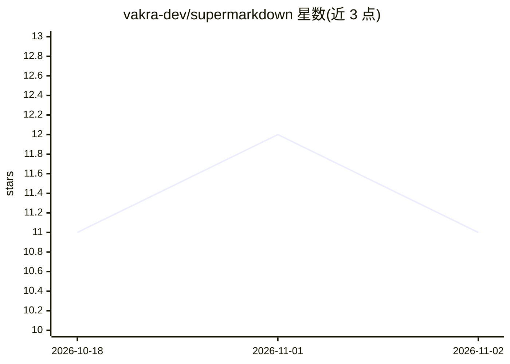

# vakra-dev/supermarkdown

⭐ 11 · Rust · MIT · 推送 2026-09-12 · [GitHub](https://github.com/vakra-dev/supermarkdown) · [官网](https://supermarkdown.dev/) · 个人维护

**Rust 编写的 HTML 转 Markdown 转换器，供 Node.js 与 Rust 使用**

用 Rust 实现的 HTML 到 Markdown 转换库，提供同步与异步 API，完整支持 GitHub Flavored Markdown（对齐表格、删除线、autolink、围栏代码块）。解析基于 html5ever，可处理畸形 HTML。支持标题/链接样式配置、CSS 选择器过滤排除导航广告等元素、代码块语言检测与行号剔除。以 npm 包、Rust crate 和 cargo 安装的 CLI 三种形式分发，提供跨平台预编译二进制（Windows/macOS/Linux x64 与 ARM64）。限制：表格 colspan/rowspan 不支持、表单与 iframe 元素跳过、仅处理静态 HTML。

## 筛选速览

| 维度 | 判定 | 备注 |
|---|---|---|
| AI 角色 | `ai-enhanced` | 去掉 AI 部分产品仍成立 |
| 许可风险 | `permissive` | MIT |
| 部署形态 | `library` | 以包/库形式分发 |
| 模型依赖 | — | README 未给出锁定关系 |
| 硬件要求 | — | 无带数字的原话,不猜 |
| 安装摩擦 | `low` | 无编译、无系统依赖或容器化 |
| 成熟度 | — | 结构信号不足 |

## 能力要点

- 完整 GFM 支持：对齐表格、删除线、autolink、围栏代码块
- CSS 选择器过滤（excludeSelectors/includeSelectors）
- 同步 convert 与异步 convertAsync API，含 CLI
- 跨平台预编译二进制（Windows/macOS/Linux，x64 与 ARM64）

## 适用场景

- 为 LLM/RAG 管道清洗网页内容为干净 Markdown
- 批量转换爬取的网页或博客 HTML
- 将文档页面（含表格、定义列表）转为 Markdown

## 场景标签

`文档解析` · 领域:知识与检索

## 证据(README 行号)

> L7: High-performance HTML to Markdown converter with full GitHub Flavored Markdown support. Written in Rust, available f
> L94: // Extract just the article content for RAG pipelines

## 星数曲线

2026-10-18 11 → 2026-11-02 11（+0）

---
*卡片 v1 · prompt 1.4 · 生成 2026-10-31 · 置信度 high · 依据 README sha `cfb96fb62c44` · [字段定义](../../DATASET.md)*
