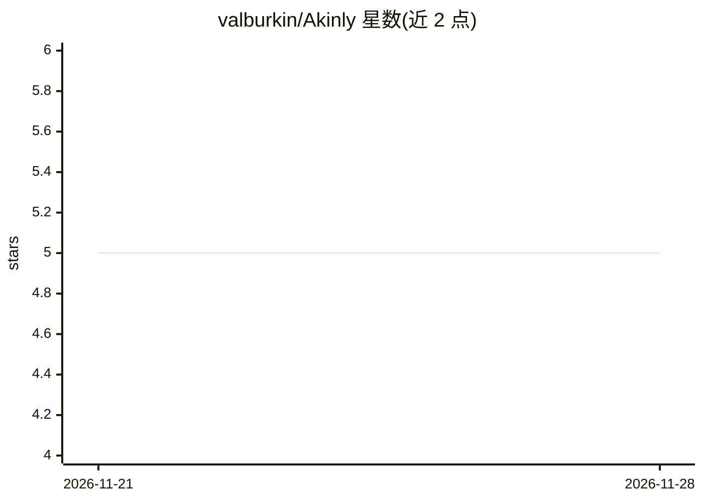

# valburkin/Akinly

⭐ 5 · C# · MIT · 推送 2026-11-22 · [GitHub](https://github.com/valburkin/Akinly) · 个人维护

**.NET 短文本增量聚类库，模糊案例可交由 LLM 判定**

面向 .NET 开发者的短文本增量聚类库：将支持工单、反馈、问卷等流式文本归入持久 id 的簇，簇合并时报告 id 重定向。核心机制是三区相似度判定——高相似直接入簇、低相似新建簇、中间带生成问题交由判定者（可选 LLM、规则或人工）裁决，仅模糊案例消耗模型调用。核心包自带内存存储与 JSON 导出，AI 包经 Microsoft.Extensions.AI 接入任意 IChatClient/IEmbeddingGenerator，向量数据包经 Microsoft.Extensions.VectorData 对接 Qdrant/pgvector。

## 筛选速览

| 维度 | 判定 | 备注 |
|---|---|---|
| AI 角色 | `ai-native` | 本体是模型或模型工具 |
| 许可风险 | `permissive` | MIT |
| 部署形态 | `None` |  |
| 模型依赖 | local-ok | 支持本地模型 |
| 硬件要求 | — | 无带数字的原话,不猜 |
| 安装摩擦 | `medium` | 含编译或系统依赖之一 |
| 成熟度 | — | 结构信号不足 |

## 能力要点

- 增量聚类，簇 id 持久且不复用，合并报告 from/into 重定向
- 仅中间相似度带生成问题交 LLM/规则/人工判定，问题可异步批量回答
- 经 Microsoft.Extensions.AI 支持 Ollama、OpenAI、Azure OpenAI 等任意模型
- 附 akinly-eval 校准工具，在五个公开数据集上给出评测结果

## 适用场景

- 把持续涌入的客服工单自动归组，每个问题只处理一次
- 聚合用户反馈/投诉并保留可外链的持久分组 id
- 对接 Qdrant 或 pgvector 持久化保存簇状态
- 用本地 Ollama 模型在无云端调用下聚类

## 场景标签

 · 领域:开发工具/NLP 文本聚类

## 证据(README 行号)

> L13: Incremental clustering of short texts for .NET. Akinly groups items that say the same thing (support tickets, feedb
> L43: |`Akinly.AI`|`TextClusterer` (texts in, clusters out), `ChatClientJudge`, `ChatClientLabeler`, `JudgePrompts`|You w
> L153: - .NET 10 (`net10.0`). The SDK version used to build is pinned in global.json.

## 星数曲线

2026-11-21 5 → 2026-11-28 5（+0）

---
*卡片 v1 · prompt 1.4 · 生成 2026-11-21 · 置信度 high · 依据 README sha `f509e02e6788` · [字段定义](../../DATASET.md)*
