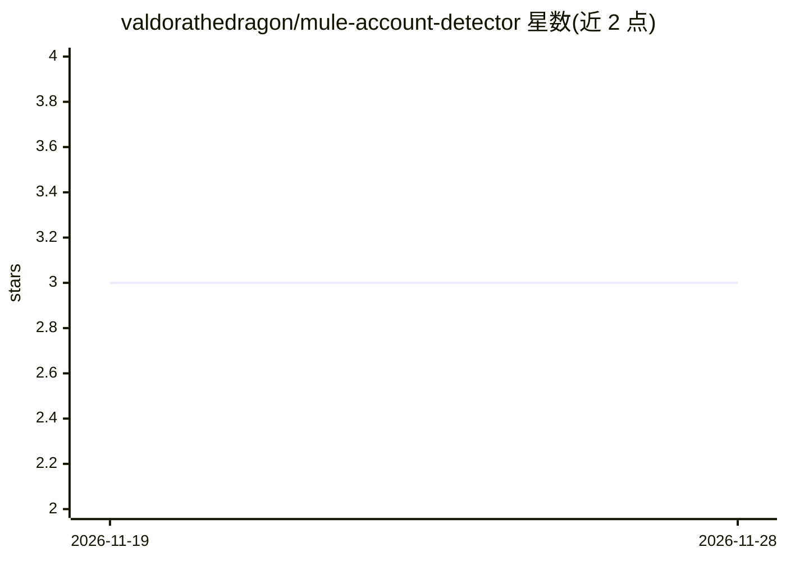

# valdorathedragon/mule-account-detector

⭐ 3 · Python · 推送 2026-11-21 · [GitHub](https://github.com/valdorathedragon/mule-account-detector) · 个人维护

**面向银行合规调查员的洗钱骡子账户检测工作台**

基于 IBM AML（HI-Small_Trans.csv）基准数据构建的反洗钱调查工作台：数据管道将交易映射为印度多类银行实体并计算 Pass_Through_Ratio 与近限速率特征，IsolationForest 输出 0–100 风险评分，图引擎提取 2-hop 邻域计算 degree_asymmetry 区分聚合/分发/中继型账户，Gemini 生成符合 PMLA 2002 与 RBI KYC 规则的 SAR 报告（带离线确定性回退）。以 Streamlit 单页应用交付，git clone 后 pip 安装依赖运行。README 标注 precision/recall 为场景校准结果而非泛化指标。

## 筛选速览

| 维度 | 判定 | 备注 |
|---|---|---|
| AI 角色 | `ai-native` | 本体是模型或模型工具 |
| 许可风险 | `none` | — |
| 部署形态 | `library` | 以包/库形式分发 |
| 模型依赖 | — | README 未给出锁定关系 |
| 硬件要求 | — | 无带数字的原话,不猜 |
| 安装摩擦 | `low` | 无编译、无系统依赖或容器化 |
| 成熟度 | — | 结构信号不足 |

## 能力要点

- IsolationForest 异常评分转为 0–100 可解释风险分
- 2-hop 图拓扑 degree_asymmetry 区分 Fan-In/Fan-Out/Pass-Through 账户
- Gemini 生成 FIU-IND SAR 报告并提供离线确定性回退
- Plotly Sankey 与 PyVis 拓扑图、一键导出 STR/SAR 文件

## 适用场景

- 对印度多银行网络的交易数据做骡子账户筛查
- 为可疑账户生成 FIU-IND 格式的 SAR 报告初稿
- 以图拓扑可视化调查可疑账户的 2-hop 资金流

## 场景标签

`金融量化` · 领域:学习与行业

## 证据(README 行号)

> L24: Powered by the **IBM AML (`HI-Small_Trans.csv`)** transactional benchmark, FINSIGHT unites **unsupervised `Isolatio
> L38: 4. **FIU-IND Regulatory SAR Generator (`src/sar_generator.py`)**: Synthesizes formal, evidence-grounded two-paragra
> L56: pip install -r requirements.txt

## 星数曲线

2026-11-19 3 → 2026-11-28 3（+0）

---
*卡片 v1 · prompt 1.4 · 生成 2026-11-21 · 置信度 high · 依据 README sha `d83c8206b281` · [字段定义](../../DATASET.md)*
