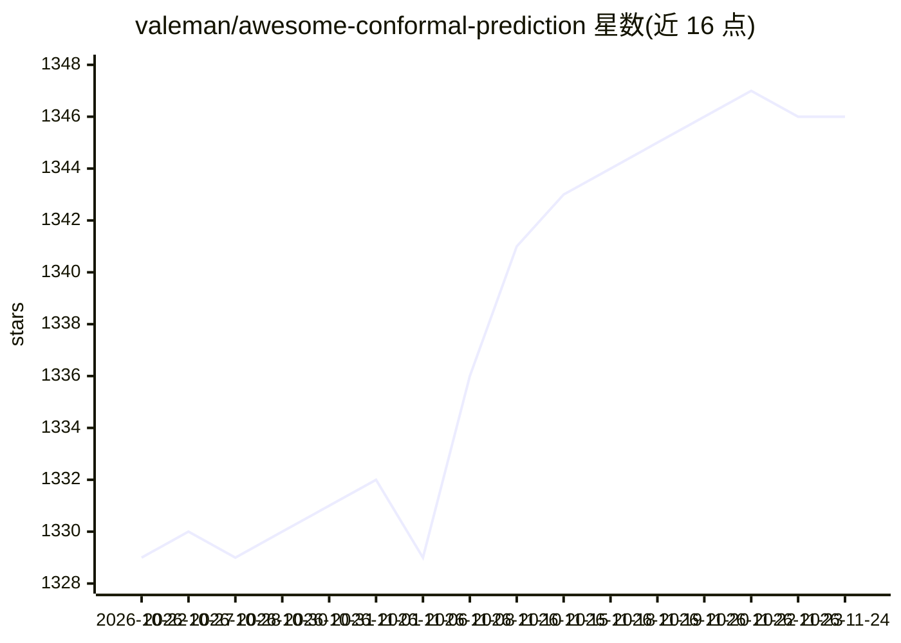

# valeman/awesome-conformal-prediction

⭐ 1,346 · 推送 2026-11-21 · [GitHub](https://github.com/valeman/awesome-conformal-prediction) · 个人维护

**共形预测（Conformal Prediction）资源的策展清单**

由 Valery Manokhin（PhD）维护的共形预测资源指南，收录教程、研究论文、Python/R 库与可运行示例，覆盖预测区间、分类集合、时间序列预测、异常检测与 LLM 不确定性等主题。条目按重要性编排，作者本人的书籍、课程与资源置于各节开头；🔥 标注经审阅的核心参考文献，🕒 标注时间序列资源，并附 Quickstart 笔记本演示回归与分类的校准流程。

## 筛选速览

| 维度 | 判定 | 备注 |
|---|---|---|
| AI 角色 | `ai-knowledge` | 知识聚合/清单类 |
| 许可风险 | `none` | — |
| 部署形态 | `library` | 以包/库形式分发 |
| 模型依赖 | — | README 未给出锁定关系 |
| 硬件要求 | — | 无带数字的原话,不猜 |
| 安装摩擦 | `low` | 无编译、无系统依赖或容器化 |
| 成熟度 | — | 结构信号不足 |

## 能力要点

- 覆盖教程、论文、书籍、硕博论文与开源库的资源聚合
- 🔥/🕒 标记核心参考文献与时间序列资源
- 附 NumPy/scikit-learn 可运行 Quickstart 笔记本
- 收录 Python 与 R 共形预测库清单

## 适用场景

- 查找共形预测的入门教程与核心论文
- 为机器学习模型的不确定性量化选库
- 了解 LLM 与视觉等领域的共形预测最新研究

## 场景标签

`精选清单` · 领域:学习与行业

## 证据(README 行号)

> L1: # Awesome Conformal Prediction
> L11: A curated guide to **conformal prediction**, also known as conformal inference. Find tutorials, research papers, Py
> L78: ## Table of Contents

## 星数曲线

2026-10-22 1,329 → 2026-11-24 1,346（+17）

---
*卡片 v1 · prompt 1.4 · 生成 2026-11-23 · 置信度 mid · 依据 README sha `f96a01df6f51` · [字段定义](../../DATASET.md)*
