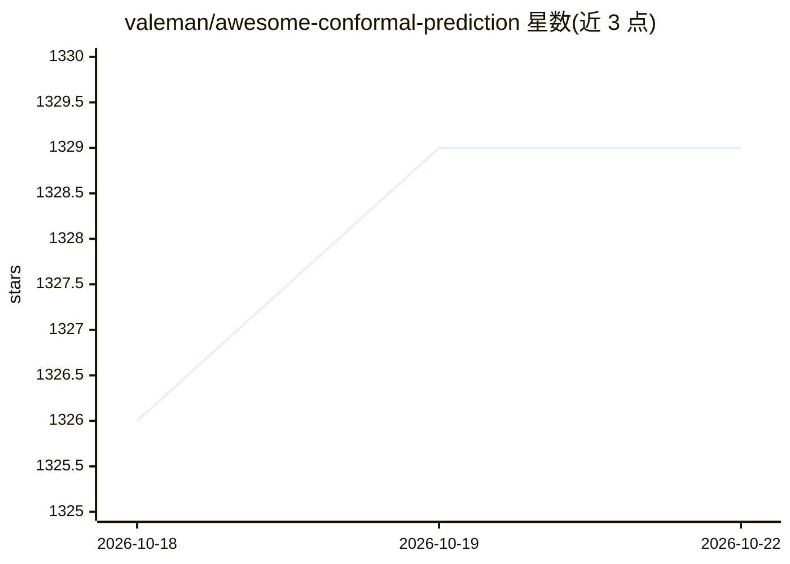

# valeman/awesome-conformal-prediction

⭐ 1,329 · NOASSERTION · 推送 2026-08-25 · [GitHub](https://github.com/valeman/awesome-conformal-prediction) · 个人维护

**共形预测（Conformal Prediction）资源策展清单：教程/书籍/论文/课程**

由 Dr. Valeriy Manokhin（Vladimir Vovk 指导下的机器学习博士）维护的共形预测主题 awesome 清单，收录视频、教程、书籍、论文、硕博论文、文章与开源库，主题覆盖预测区间、不确定性量化、模型校准、LLM 不确定性、时间序列与异常检测。README 附共形预测方法简介（校准集与非一致性分数分位数构造预测集）、基于 crepes 的最小代码示例与可运行 notebook，并推广作者本人的付费课程与两版书籍（Gumroad 发售）。资源按🔥分级标注，内容声称定期更新至 2025–2026。

## 筛选速览

| 维度 | 判定 | 备注 |
|---|---|---|
| AI 角色 | `ai-knowledge` | 知识聚合/清单类 |
| 许可风险 | `none` | NOASSERTION |
| 部署形态 | `None` |  |
| 模型依赖 | — | README 未给出锁定关系 |
| 硬件要求 | — | 无带数字的原话,不猜 |
| 安装摩擦 | `low` | 无编译、无系统依赖或容器化 |
| 成熟度 | — | 结构信号不足 |

## 能力要点

- 收录教程、课程、书籍、文章等多类型共形预测资源并按热度分级
- README 含共形预测方法说明（校准集、非一致性分数、1−α 分位数）
- 提供基于 crepes 库的最小可运行示例与 examples/ 目录 notebook
- 覆盖 LLM 不确定性、时间序列、异常检测等应用主题

## 适用场景

- 系统性学习共形预测方法并找到入门路径
- 查找共形预测的开源库与实践文章
- 为不确定性量化和模型校准需求定位教程与书籍

## 场景标签

 · 领域:机器学习/不确定性量化

## 证据(README 行号)

> L3: # Conformal Prediction: The Definitive Resource Awesome DOI
> L5: ⭐ **The definitive resource for conformal prediction: methods, libraries, tutorials, benchmarks, and production guid
> L75: This collection is curated by **Dr. Valeriy Manokhin**, who completed his PhD in Machine Learning under the supervi

## 星数曲线

2026-10-18 1,326 → 2026-10-22 1,329（+3）

---
*卡片 v1 · prompt 1.4 · 生成 2026-10-21 · 置信度 high · 依据 README sha `231afa4d1230` · [字段定义](../../DATASET.md)*
