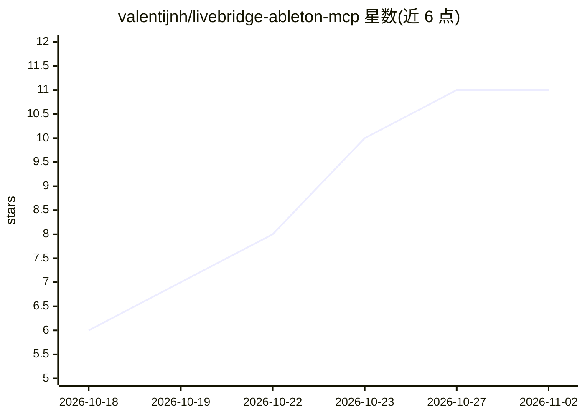

# valentijnh/livebridge-ableton-mcp

⭐ 11 · Python · MIT · 推送 2026-09-23 · [GitHub](https://github.com/valentijnh/livebridge-ableton-mcp) · [官网](https://valentijnh.github.io/livebridge-ableton-mcp/) · 个人维护

**连接 Claude 与 Ableton Live 12 的 MCP 服务器，用对话做音乐**

Model Context Protocol 服务器，把 Claude（Claude Code、Claude Desktop 或任意 MCP 客户端）接入运行中的 Ableton Live 12：提供 168 个工具（200 条底层命令），覆盖轨道、片段、MIDI、鼓组、和弦、Serum 2 等 VST3 插件参数、自动化、编排、混音与经 Splice 官方 MCP 的采样。架构为 Live 内加载的 MIDI Remote Script（TCP 服务）加 MCP 服务器，支持 macOS/Windows 及双机 LAN 模式，无需 Max for Live，每次改动为单个 undo 步。

## 筛选速览

| 维度 | 判定 | 备注 |
|---|---|---|
| AI 角色 | `ai-ecosystem` | LLM/agent 周边工具 |
| 许可风险 | `permissive` | MIT |
| 部署形态 | `library` | 以包/库形式分发 |
| 模型依赖 | locked-api |  |
| 硬件要求 | — | 无带数字的原话,不猜 |
| 安装摩擦 | `low` | 无编译、无系统依赖或容器化 |
| 成熟度 | — | 结构信号不足 |

## 能力要点

- 168 个 live_* 工具覆盖 Live API 可及的全部区域
- 经 rack preset 控制 Serum 2 等 VST3 插件参数，无需手动 Configure
- 双机 LAN 模式：Claude 与 Live 可在不同计算机，含发现与 token 鉴权
- 每次改动为单个 undo 步，1,500+ 单元测试与真机端到端验证

## 适用场景

- 用自然语言让 Claude 在 Live 里写鼓组、和弦与编排
- 在对话中控制 Serum 2 音色设计与混音
- Mac 上用 Claude 控制 Windows 工作机里的 Live

## 场景标签

 · 领域:音乐制作/AI 工具集成

## 证据(README 行号)

> L44: LiveBridge connects Claude (Claude Code, Claude Desktop or any MCP client) to a running
> L103: 2. **MCP server** (`mcp_server`, package `livebridge-mcp`) — exposes curated, validated tools to

## 星数曲线

2026-10-18 6 → 2026-11-02 11（+5）

---
*卡片 v1 · prompt 1.4 · 生成 2026-11-01 · 置信度 mid · 依据 README sha `10f9b6fba97c` · [字段定义](../../DATASET.md)*
