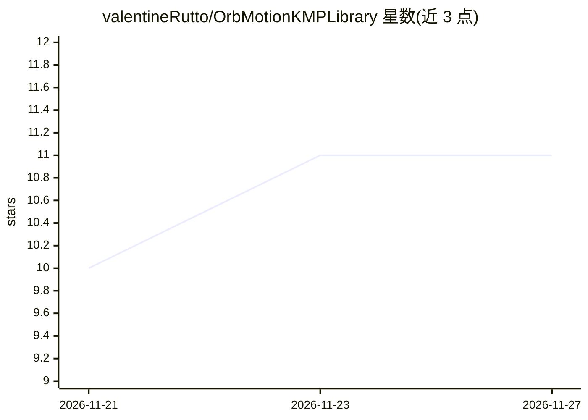

# valentineRutto/OrbMotionKMPLibrary

⭐ 11 · Kotlin · MIT · 推送 2026-11-19 · [GitHub](https://github.com/valentineRutto/OrbMotionKMPLibrary) · [官网](https://klibs.io/project/valentineRutto/OrbMotionKMPLibrary) · 个人维护

**面向 Android/iOS 开发者的 AI 活动指示动画 Compose 库**

基于 Compose Multiplatform 的 Kotlin 多平台动画库，为 AI 助手与 agent 界面提供可定制的动态球体指示器，支持不同状态、尺寸、速度与颜色参数；同一份 Compose UI 代码可在 Android 与 iOS 间复用。以 Composable 函数形式供调用（如 AnimatedThinkingOrb），发布到 Maven Central，并附演示视频与自定义示例。

## 筛选速览

| 维度 | 判定 | 备注 |
|---|---|---|
| AI 角色 | `ai-enhanced` | 去掉 AI 部分产品仍成立 |
| 许可风险 | `permissive` | MIT |
| 部署形态 | `None` |  |
| 模型依赖 | — | README 未给出锁定关系 |
| 硬件要求 | — | 无带数字的原话,不猜 |
| 安装摩擦 | `low` | 无编译、无系统依赖或容器化 |
| 成熟度 | — | 结构信号不足 |

## 能力要点

- 提供 AnimatedThinkingOrb 等可组合函数，参数含 state/size/speed/color
- 一份 Compose UI 代码复用于 Android 与 iOS
- 发布至 Maven Central，支持 Version Catalog 依赖

## 适用场景

- 为 AI 助手/聊天应用添加思考中动画指示器
- Kotlin Multiplatform 项目中跨平台复用动画 UI
- 自定义 agent 交互界面的状态反馈动画

## 场景标签

 · 领域:移动开发/UI 组件库

## 证据(README 行号)

> L6: **OrbMotion is a Kotlin Multiplatform animation library for expressive AI and agent activity indicators, built with 
> L8: It provides customizable animated orbs for AI assistants, agents, and interactive interfaces, with support for diffe
> L10: Build once with shared Compose UI and reuse the same animations across your Android and iOS applications.

## 星数曲线

2026-11-21 10 → 2026-11-27 11（+1）

---
*卡片 v1 · prompt 1.4 · 生成 2026-11-21 · 置信度 high · 依据 README sha `44f107018ec9` · [字段定义](../../DATASET.md)*
