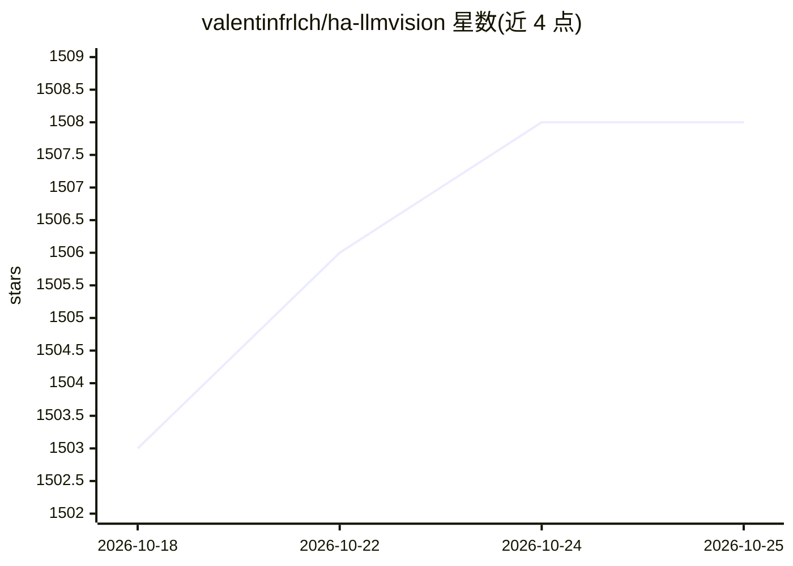

# valentinfrlch/ha-llmvision

⭐ 1,508 · Python · Apache-2.0 · 推送 2026-09-17 · [GitHub](https://github.com/valentinfrlch/ha-llmvision) · [官网](https://llmvision.org) · 个人维护

**Home Assistant 集成：用多模态大模型分析家庭摄像头画面**

面向 Home Assistant 用户的多模态视觉集成：通过 OpenRouter、OpenAI、Anthropic、Gemini、AWS Bedrock、Azure、Groq、Ollama、Open WebUI、LocalAI 及 OpenAI 兼容端点等模型提供商，分析图片、视频文件、直播摄像头画面与 Frigate 事件，按用户提示词生成描述与回答。支持记忆人物、宠物与物体，维护事件时间线（可选仪表盘 Timeline Card），并可依据从摄像头流提取的数据更新传感器。通过 HACS 安装，附摄像头事件 AI 摘要 Blueprint。

## 筛选速览

| 维度 | 判定 | 备注 |
|---|---|---|
| AI 角色 | `ai-native` | 本体是模型或模型工具 |
| 许可风险 | `permissive` | Apache-2.0 |
| 部署形态 | `None` |  |
| 模型依赖 | local-ok | 支持本地模型 |
| 硬件要求 | — | 无带数字的原话,不猜 |
| 安装摩擦 | `low` | 无编译、无系统依赖或容器化 |
| 成熟度 | — | 结构信号不足 |

## 能力要点

- 分析图片、视频、直播摄像头与 Frigate 事件，基于提示词生成描述
- 支持 OpenRouter/OpenAI/Anthropic/Gemini/Bedrock/Azure/Groq/Ollama/Open WebUI/LocalAI 及 OpenAI 兼容端点
- 记忆人物、宠物与物体，维护事件时间线并可选 Timeline Card
- 依据摄像头流/图片/视频提取的数据自动更新传感器

## 适用场景

- 我想让家里的摄像头事件自动生成 AI 摘要通知
- 在 Home Assistant 仪表盘查看摄像头事件时间线
- 向 Assist 询问摄像头记录的事件内容

## 场景标签

`多模态` · 领域:感知与多模态

## 证据(README 行号)

> L20:  LLM Vision is a Home Assistant integration that uses multimodal large language models to analyze images, videos, l
> L24: - Answers questions and provides descriptions of images, video files, live camera feeds, and Frigate events based o

## 星数曲线

2026-10-18 1,503 → 2026-10-25 1,508（+5）

---
*卡片 v1 · prompt 1.4 · 生成 2026-10-21 · 置信度 high · 依据 README sha `c9bf76885ae3` · [字段定义](../../DATASET.md)*
